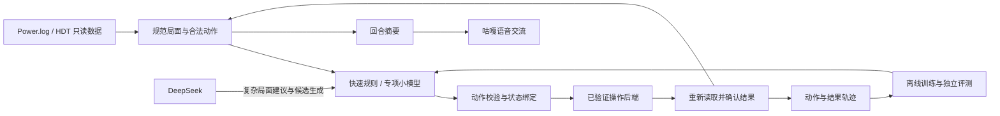

# DeepBattler 与 AI Gaming Agent MCP：源码核对与采用路线

核对日期：2026-10-23。本轮仅下载公开源码和模型元数据、检查实现，并隔离验证三个纯 JSON/奖励函数。未安装插件、未下载模型权重、未启动模型服务、未调用付费模型、未向游戏窗口发送输入。参考资料放在 `runtime/references/`，该目录已加入忽略规则，不进入发行包。

## 结论

DeepBattler 可以为本项目提供 HDT 数据组织、回合历史、战棋专项小模型训练的参考；其 Hugging Face 项目确实提供训练代码和 LoRA 模型文件。它不能直接填补当前客户端动作执行桥，也没有已核实的当前版本完整模拟器或自动上分证明。

AI Gaming Agent MCP 提供通用截图和鼠标键盘工具，可以借鉴工具接口和工作流组织；其输入后端是 PyAutoGUI，没有发现它能通过内存执行炉石动作的证据。当前本地已有窗口输入执行器，无须为获得相同能力再安装整套服务。

## 固定参考版本

| 来源 | 核对版本 | 用途 |
| --- | --- | --- |
| [DeepBattler](https://github.com/william-Dic/DeepBattler) | `da31b8cfebab9ef30ce7af5cc57a19ef8dd9ef07`，2025-11-30 | HDT 插件、实时语音建议、数据记录 |
| [AI Gaming Agent MCP](https://github.com/developerz-ai/ai-gaming-agent-mcp) | `3cae67f652a61382eb462d971aa1612e92cbfea6`，2026-01-23 | 通用操作工具与工作流 |
| [DeepBattler-RL Space](https://huggingface.co/spaces/iteratehack/deepbattler/tree/fed1ca78e8f0059401bc6336f1df83b49b8ab73e) | `fed1ca78e8f0059401bc6336f1df83b49b8ab73e` | SFT、GRPO、评测、FastAPI 推理代码 |
| [战棋 LoRA](https://huggingface.co/iteratehack/battleground-rlaif-qwen-gamehistory-grpo/tree/946e78e38d2ee24d5b391c1e10a9a2ce1c3e144a) | `946e78e38d2ee24d5b391c1e10a9a2ce1c3e144a` | 基座 `Qwen/Qwen3-4B-Instruct-2507`，LoRA rank 16 |

GitHub 网页读取工具本轮返回 403，改用公开仓库 git clone；Hugging Face 使用公开 API 和 raw 文件。没有把 README 宣传语当作实测结果。

## DeepBattler 真正实现了什么

`DeepBattlerPlugin/Class1.cs` 订阅 HDT 的游戏开始、回合开始、结束和回到菜单事件，并在 `OnUpdate()` 中更新状态。它从 HDT 的实体对象读取英雄、血量、金币、酒馆等级、手牌、棋盘和商店，写成本地 JSON。README 所称 API endpoint，在这条已核对的数据链上主要是文件供给，而不是可调用游戏动作的 RPC。

`Agent/real_time_caller/gemini_live.py` 把 JSON 拼入系统提示，使用 Gemini Live 语音和另一个文本生成调用给建议。状态监控约每两秒检查一次，状态变化会设置重连标志来更新系统提示。这适合借鉴“结构化局面供给语音角色”的分工；频繁断线重连不适合照搬到咕嘎已有长语音会话。

独立的 Hugging Face Space 增加了：

- 专家动作的 SFT 热身与 LoRA 微调。
- 带 expert / medium / bad 候选标注的 GRPO 训练。
- 输出整回合 `actions` 序列，支持买入、出牌、卖出、英雄技能、刷新、升本、冻结、结束回合等动作名称。
- `POST /generate_actions` 推理接口。

这些动作名称是模型输出协议，不等于对应客户端操作已实现。GitHub 主项目中未找到鼠标键盘执行链或 `SendOption` 调用链；Hugging Face 的推理接口也只生成动作。

## 必须修正或验证的问题

1. **胜负标签会失真。** `Class1.cs:273` 附近用英雄血量变化判断胜负：增加判赢、减少判输、不变判平。正常赢下战斗也可能不掉血，因此这种推断不能作为真实胜负标签。应读取明确战斗结果，无法确认时保留 unknown。
2. **动作记录尚未闭环。** `Class1.cs:325` 的 `ActionTaken` 初始化为空，指南要求另行从 Python 输出补入。建议文本、尝试执行的动作、客户端确认的动作必须分开保存。
3. **负奖励被截断。** HF 训练脚本 `RL/train_battleground_rlaif_gamehistory.py:547` 初始化 `best_reward=0.0`，仅在候选奖励更大时更新。严格匹配 bad 候选的 -0.5 最后得到 0.0；坏动作、无匹配动作和无效 JSON 在这个例子中都得到 0.0。评测脚本也有相同模式。
4. **评测不等于实战。** 已核对评测指标主要是专家动作序列精确匹配率和候选奖励，没有在本次资料中核实八人对局名次或当前版本天梯实力。模型卡的训练数据、评测和结果仍大部分是模板占位。
5. **不能直接照抄规则和定位。** 提示词含硬编码费用等简化描述；输出主要按商店、手牌和棋盘序号定位。我们的执行层必须绑定实体 ID、选项代次、局面指纹，并在每次动作后重新读状态。购买、三连或发现会改变位置，整回合计划不能盲目连续执行。
6. **不是完整离线模拟器。** 已检查的 GitHub 源码和 HF Space 提供数据采集、模型训练及推理，未发现完整八人环境和当前全卡效果规则实现。现有离线引擎的规则补全工作仍然需要继续。

负奖励隔离验证输出保存在 `runtime/references/DeepBattler-RL/reward-audit.json`。仅从 AST 选取三个已审阅的纯函数运行；没有导入原训练模块及其 Torch/TRL 依赖。四个输入分别验证坏候选、专家候选、无匹配和无效 JSON，实际奖励为 0、1、0、0。该验证只证明上述奖励实现行为，不评价其模型水平。

## AI Gaming Agent MCP 借鉴范围

`src/ai_gaming_agent/tools/mouse.py` 使用 `pyautogui.click/dragTo`；`workflow.py` 顺序调用工具并使用固定等待。批量执行可以减少模型往返，但工具返回 success 主要代表调用未抛异常，不能证明买到随从或成功开始匹配。输入模块还关闭了 PyAutoGUI 自带 fail-safe，不能原样照搬到本项目的人工停止机制。

采用其“统一工具协议”和“有限工作流”的组织方式；继续保留本地逐步确认、局面变化即废弃旧动作、停止开关及真实日志回执。状态变化动作每步确认，纯本地计算可以批量完成。

## 本地采用顺序

1. 先完善真实操作闭环：进入游戏、启动门、酒馆入口、匹配、英雄选择，以及现有买卖出牌的明确结果回执。当前截图证明启动门的“点击开始”也必须成为独立阶段；历史界面截图不能当作当前点击坐标。
2. 参考 DeepBattler 的数据字段，但保留本地已有实体、选项和费用校验。输出标准轨迹 `state_before → proposed → executed → verified → state_after`，建议和执行失败均不得冒充成功样本。
3. 将其 Qwen3-4B + LoRA 当作候选策略。先在本地固定版本的离线数据上检查动作合法率，再做独立种子对局，与当前规则及现有候选同台比较。达到晋级条件后才启用实局，现阶段不替换策略。
4. 保留 DeepSeek 处理难局、生成候选和解释；高频操作使用本地策略及校验。DeepSeek 给动作打分属于模型评审，不能替代模拟器的真实转移和最终名次。
5. 继续补全当前版本模拟器，然后使用八人对局的名次、存活和局面价值训练。对同一局面多采样，用模拟结果区分好坏；避免仅奖励复述已标注动作。

本轮没有宣称已完成上述集成。此报告只完成公开项目的实现核对、局部缺陷复现与本地采用顺序整理。

## 版本和分发说明

最新用户截图显示战网完整版本 `37.0.0.255130.254477`。此前分别观察到 255130 和 254477，单凭这两个数字不同不能判断是不同发布；二者同时存在于完整版本字符串中。当前完整规则仍未验证，原因是卡牌效果、英雄和特殊选择覆盖不足，不能只用版本字符串相同来认定完成对齐。

DeepBattler README 使用自定义非商业许可；AI Gaming Agent MCP 为 MIT。LoRA 模型卡未填清许可。本轮只在本地参考源码和元数据，不把第三方代码或权重并入公开安装包；将来若直接复用或分发，需按各自许可保留声明并核对适用范围。
