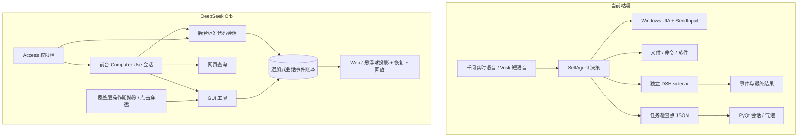

# DeepSeek Harness Orb 调研：咕嘎能摘哪些桃

调研快照：`mini-yifan/deepseek-harness-orb`，提交 `225379f1097313df75f9be7b7a5409b82cc2e62e`（2026-10-12），MIT 许可。它是 [DeepSeek Harness](https://github.com/deepseek-ai/deepseek-harness) 的社区衍生桌面产品，基于 `dsh 0.2.1-alpha.2`；仓库包含约 1.5 万个文件、52 个包目录、约 57 MB 源码（未计 `node_modules`），属于实验性、完整的 Electron/Node 产品，不是一个小插件。

## 先给结论

有值得吸收的东西，但不建议把整个 Orb 塞进咕嘎。咕嘎是 Python/Qt 桌宠，优势是千问实时语音、人格气泡、本地快速命令、Windows UIA + SendInput，以及已有 DSH 长任务 sidecar；Orb 是 Electron + DSH Web UI，README 明确写了没有语音、圈选和逐次审批。整包移植会多背一套 Node、Electron、插件市场和设置界面，还会和现有语音、桌宠、权限链打架。

最值得借的是下面四样，按实际收益排序：

1. **把任务当成一本“不可篡改的流水账”**。每次模型请求、回答、工具调用、结果、失败、权限变化都按顺序写进会话日志，界面和后续上下文都从账本重建。这样能不丢步骤、能恢复、能复盘，也能压住“没做却说已经做好”的问题。
2. **前台“服务员”与后台“后厨”分开**。看得见的点击、输入留在前台会话；翻文件、写文档、搭网站交给后台代码会话。后台受理后马上返回，任务完成时等到前台空闲再把摘要带回。咕嘎目前已有快速命令、工具循环和 `dsh_task` sidecar，但事件账本和完成通知的交接还不够统一。
3. **把权限写成会话级档位**。Orb 悬浮球有“仅查看、工作区内修改、完全权限”，改变后作用于它当前和派出的后台任务。咕嘎目前主要是整机“完整访问”开关，适合个人机，但对外发布、运行陌生人任务或做长时间任务时边界太粗。
4. **让桌宠不挡住操作，也不进入截图**。Orb 在 Computer Use 的截屏和整段输入期间临时排除悬浮球、面板和工具条，并让覆盖层点击穿透。咕嘎目前会在操作前隐藏pet并恢复，容易闪动，也可能让观察画面和点击路径不一致。

## 可直接用的与只能借鉴的

| 内容 | 能不能直接拿 | 对咕嘎的现实价值 |
|---|---|---|
| DSH headless / SDK / 会话事件格式 | **可通过现有 sidecar 直接采用**。项目 MIT；咕嘎当前安装的是 `dsh 0.1.7-rc.2`，Orb 用的是 `0.2.1-alpha.2`。 | 咕嘎已经有 `core/dsh_worker.py`，升级后可以把 DSH 的完整工具事件投影到咕嘎的对话时间线、任务检查点和语音汇报，而不是只收 `turn_end` 和 final。建议先固定一个版本做兼容测试，不盲目追最新 alpha。 |
| `code_agent` 的前后台分工、完成通知 | 逻辑可直接学习，代码是 DSH 插件/TypeScript。 | 适合改变咕嘎“所有复杂任务都塞在一个 SelfAgent 循环里”的结构。重点不是多一个窗口，而是任务 acceptance、后台 session、完成回流三件事各有明确状态。 |
| 会话权限预设 | 若 DSH 侧car可用其 permission preset；咕嘎自身 Windows 工具仍需单独实现策略。 | 先给 `dsh_task` 落地“只读 / 工作区内 / 完全”三档；再考虑把 UIA、SendInput、文件、命令按档位过滤。保持管理员能力作为显式、单选、可恢复的最高档。 |
| 覆盖层截图排除和点击穿透 | Windows 概念可借，Electron 实现不能直接塞进 Qt。 | 给咕嘎的 pet、气泡、对话框增加操作期间的临时 capture exclusion / click-through；比整个窗口 hide/show 更自然，减少桌面跳闪。 |
| 0–1000 千分比坐标模式 | 思路可借；咕嘎目前是“截图相对像素”。 | 混合 DPI、截图缩放、多显示器下，归一化坐标能减少模型对像素图的误解。可作为另一坐标模式，保留像素模式对照验证，不要一次全局替换。 |
| 操作后立即重截并回传给模型 | 已有同方向实现，但不建议替换咕嘎现有验证链。 | 借鉴“一次输入后重新观察”的强约束；当前咕嘎也有 observation ID 和操作后复查，已具备基本闭环。 |
| 划词工具条 | 可参考交互规则，不能直接复制 Electron 控制器。 | 参照“无真实选区不弹、按键/滚轮/右键收起、重复选择去重、不抢前台焦点”的规则。咕嘎现已改用缓存选区画面并验证通过，继续保留这条路径即可。 |
| Electron 主窗口、球体动画、插件市场、设置页 | **不建议整合**。 | 这些是 Orb 的产品外壳，会与咕嘎现有 PyQt 悬浮窗、桌宠形象、声音配置重复。咕嘎真正缺的是执行账本和权限边界，不是再装一套 UI。 |

## 咕嘎现状对比

咕嘎的优势没有丢：声音入口、人格、快速本地命令、Windows 管理权限、战棋和歌曲，Orb 都没有同等能力。Orb 对 Windows 的公开限制还包括“管理员身份运行的目标窗口拒绝被点击和输入”，而咕嘎当前管理员进程已经能处理同级窗口。这部分绝不能为了换框架而退化。

DSH/Orb 的账本更像银行流水：先记下“谁在何时请求了什么”，再记“工具做了什么、结果是什么”。咕嘎的任务检查点目前更像阶段性便签，能记目标和摘要，但不是完整事件账本。这是两者最大的工程差距，也是解释“为什么看似有工具却不稳定”的关键。

## 推荐落地路线

第一阶段只做能直接改善可靠性的小改动，不改语音和桌宠：

- 给现有 `dsh_task` 加“会话时间线”：把 session、step、tool、error、final 按顺序保存，并在咕嘎执行记录中显示可展开步骤；不要把隐藏思维链暴露出来。
- 后台完成摘要进入“待播报队列”：用户还在说话或咕嘎正在播报时先排队，空闲时再通过气泡和语音交付。
- 每个 DSH 任务显式携带“只读 / 工作区内 / 完全”权限和真实 `cwd`，禁止因相对路径猜目录而到处修改。
- 对一条低风险的合成任务做升级/回滚对照，验证 0.2.1 是否兼容现有 `--json` 输出；失败就停在 0.1.7，不拿日常任务当试验品。

第二阶段才处理操作层：

- 先将 pet、气泡、工具条纳入操作期点击穿透和截图排除；验证用户仍能随时停止。
- 增加归一化坐标作为可切换模式，在多 DPI/多显示器上对比 UIA 和像素点击成功率。
- 将“前台 GUI、网页、文件命令、后台 DSH”的路由写进提示词和工具契约，让模型在任务中途知道何时继续看屏幕、何时交给后厨。

第三阶段再考虑重架构：如果 DSH 0.2.1 的会话/sidecar 接口在真实任务中证明稳定，可把“任务进度记录”逐步从自定义 JSON 迁到 DSH 事件投影；不要直接替换整个 Qt 外壳。

## 一句话规则

**拿它的账本、权限档和前后台交接，保留咕嘎的耳朵、嘴、形象和 Windows 执行器；不要为了“看起来像 Orb”重写整套桌面程序。**

## 证据与边界

- Orb 自述架构、十三项 GUI 工具、坐标模式、权限芯片、后台 `code_agent`、完成通知和已知限制见仓库 [README.zh.md](../../runtime/research/deepseek-harness-orb/README.zh.md) 与 [desktop.zh.md](../../runtime/research/deepseek-harness-orb/docs/user/guide/desktop.zh.md)。
- DSH 的会话日志、Turn/Step/Event、插件与能力 seam 见 [architecture.zh.md](../../runtime/research/deepseek-harness-orb/docs/architecture.zh.md) 和 [session.zh.md](../../runtime/research/deepseek-harness-orb/docs/subsystems/session.zh.md)。
- Computer Use 的十三个 GUI 工具、每次操作重截、覆盖层排除、管理员提权限制见 [tool-computer-use README](../../runtime/research/deepseek-harness-orb/packages/experimental/tool-computer-use/README.zh.md)。
- Orb 是实验项目，源码快照没有在本机安装、运行或跑其全套测试；本报告只把文档和源码作为设计证据，不把其自述能力当成咕嘎已接通能力。仓库本身声明未做安全审计，MIT 许可仅说明可复用范围，不消除实验性风险。
