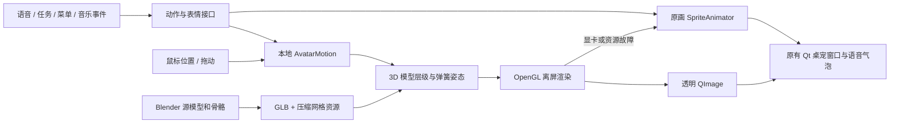

# 咕嘎桌宠：开源项目调研与 Blender 形象升级

> 当前状态：用户反馈侧背壳破坏原图观感后，已恢复原版贴图。此页保留为开发实验记录；3D 普通菜单入口与自动演示均已停用。

日期：2026-10-26。范围仅为角色表现层；不修改模型供应商、密钥、任务执行或游戏决策。

## 结论

有立体感的桌宠通常由三部分组成：**有体积的角色资源、独立的动画控制器、透明桌面窗口**。语言模型只发送“高兴、探头、唱歌”等事件；每秒几十帧的骨骼、物理摆动和渲染由本地程序处理。

本次以原图形象一致为最高优先级，默认保留原版原画，继续使用已有 Qt 桌面窗口。Blender 预览采用“原画头部曲面 + 背面体积 + 3D 身体”的混合方案，保留企鹅帽、发夹和头发的原图细节，不用通用几何体重新设计头部。没有将别人的整套桌宠程序嵌入项目，也没有下载别人的角色模型。

## 调研项目

以下项目均查看了官方仓库；重点项目进一步读取了对应源码。许可证仅概括所检查的代码仓库，不能代替角色、音频、模型的单独授权。

| 项目 | 形态与技术 | 值得借鉴的实现 | 本次取舍 |
|---|---|---|---|
| [AIRI](https://github.com/moeru-ai/airi) | Live2D / VRM 等多种角色后端；仓库 MIT | 独立角色舞台、骨骼动作、眨眼，以及参数弹簧的阻尼与小步积分 | 用独立动作层和弹簧注视，不迁移现有语音系统 |
| [desktop-homunculus](https://github.com/not-elm/desktop-homunculus) | Bevy、透明桌面窗、VRM/VRMA；README 标明 Rust 代码 MIT OR Apache-2.0 | 模型位置、注视、表情、SpringBone 可独立控制；支持代理通过 API/MCP 驱动 | 借鉴分离的控制接口，不新增 Bevy 常驻进程 |
| [Amica](https://github.com/semperai/amica) | Three.js + three-vrm；MIT | 使用 elapsed/delta 驱动程序化骨骼；语音、情绪、表现分开 | 呼吸、头部与身体不同步的次级动作由本地计算 |
| [VPet](https://github.com/LorisYounger/VPet) | WPF、PNG/APNG、丰富互动；代码 Apache-2.0，动画有独立说明 | `IGraph` 明确准备、失败、运行、结束和释放；图形与功能分开 | 保留原画后端、缓存菜单和失败回退，不因换形象重启任务 |
| [Inochi2D](https://github.com/Inochi2D/inochi2d) | 网格变形的 2D 木偶；BSD-2-Clause | 分层绘制、参数驱动网格，以 2D 素材产生深度感 | 原画模式增加平滑注视与拖动回弹；目前没有完整拆层原画，未声称接入 Inochi SDK |
| [three-vrm](https://github.com/pixiv/three-vrm) | Three.js 上的 VRM 运行库；MIT | 标准化人形骨架、表情、SpringBone，以及 VRMA 动画 | 作为后续通用 VRM 导入的参考；本次自定义短肢模型采用 GLB，不冒充 VRM |
| [Mate Engine](https://github.com/shinyflvre/Mate-Engine) | Unity / VRM 桌面角色 | 鼠标跟随、接触区域、拖动动作、音乐舞蹈、平滑切换 | 借鉴交互设计；其混合许可与默认角色再分发限制需要区分，本次不复制其代码和模型 |

## 具体查看的源码

- AIRI：[弹簧控制器](https://github.com/moeru-ai/airi/blob/3692652154f351894898b55a7b995ab0daa4a272/packages/stage-ui-live2d/src/composables/live2d/motion-control-spring.ts)、[VRM 动画](https://github.com/moeru-ai/airi/blob/3692652154f351894898b55a7b995ab0daa4a272/packages/stage-ui-three/src/composables/vrm/animation.ts)。弹簧有位置、速度、刚度、阻尼，且限制单次积分步长，避免卡顿后数值爆炸。
- Amica：[程序化骨骼动画](https://github.com/semperai/amica/blob/ca2415c77d20ec41dd4fcf917dbb0e97961ddf08/src/features/proceduralAnimation/proceduralAnimation.ts)、[注视目标](https://github.com/semperai/amica/blob/ca2415c77d20ec41dd4fcf917dbb0e97961ddf08/src/features/emoteController/autoLookAt.ts)。持续小动作不需要每帧调用语言模型。
- desktop-homunculus：[注视 API](https://github.com/not-elm/desktop-homunculus/blob/30d11a5ad72f97f405117086839acd0ea87e1c49/engine/crates/homunculus_api/src/vrm/look.rs)、[SpringBone API](https://github.com/not-elm/desktop-homunculus/blob/30d11a5ad72f97f405117086839acd0ea87e1c49/engine/crates/homunculus_api/src/vrm/spring_bones.rs)。鼠标注视和次级运动是可组合能力。
- VPet：[IGraph](https://github.com/LorisYounger/VPet/blob/70263b91e3af9d68006b33c95ad63f59858ecbbe/VPet-Simulator.Core/Graph/IGraph.cs)。资源失败与结束回调属于动画系统契约。
- Inochi2D：[动画播放器](https://github.com/Inochi2D/inochi2d/blob/4975d247f9b946a74d18e0ba9b3e9475eb636efb/source/inochi2d/animation/player.d)。动画按经过时间推进，而非假设每次回调都准时。

未做各项目二进制安装、整机性能排行或长时间稳定性对比；以上为仓库与源码调研。

## 本次实现



### 资源

- `resources/models/guga_3d/guga.blend`：可编辑的 Blender 4.2 源文件，含角色网格、材质、骨架、刚性蒙皮、原图参考、灯光和相机。原图贴图已打包进文件。
- `resources/models/guga_3d/guga.glb`：通用模型交换文件，含 1 套蒙皮以及 idle / spin / sneak_peek / dance / wave 五套动画。
- `resources/models/guga_3d/avatar.mesh.json.gz`：Qt 实时渲染实际读取的压缩网格，约 0.48 MB。不是每次启动 Blender，也不是预先录好的转圈视频。
- 建模脚本 `tools/build_blender_avatar.py` 可以重建资源。当前约 3.5 万三角形，整个头部使用本地原画投射到曲面；没有新增外部素材授权。

### 动作与互动

- 真正沿竖轴转一整圈，可见侧面和背面。
- 暗中观察：身体侧移、倾斜，头部反向补偿并转向，随后回到原位。
- 舞蹈：身体、头部、双翅各用不同相位。动作层预留头发弹簧参数，当前原画曲面头部没有独立拆出的发束，因此不宣称已实现独立头发物理。
- 鼠标靠近时平滑转头；拖动时身体倾斜，松手后回弹。
- 墨镜绑定头部锚点，跟随转头；普通戴镜动作约 8 秒后恢复，唱歌期间由音乐状态持有。
- 六种原画表情可从菜单切换，也继续接收原有语音/情绪事件。
- 默认保持原版原画；右键 → 音乐与动作 → 形象，可手动查看“原画曲面 3D · 预览”，也可随时切回原版。选择保存在独立的外观配置中，不改 API 配置。
- 15 秒本地动作展示会自动结束；不调用模型，不打开麦克风，不播放歌曲。

### 工程保护

- 只运行当前形象的动画定时器。切换时保留表情、说话幅度、舞蹈、墨镜状态，画布尺寸不变。
- 3D 失败时恢复原画；渲染上下文、FBO、纹理、显示列表有明确释放路径。
- 离屏 FBO 配置深度缓冲与透明通道；在渲染上下文仍有效时读取图像。
- 目标 30 FPS；按实际时间推进 3D 动作。跟随计算留在本地，不占用语言模型 token。
- 新增 PyOpenGL 依赖，更新后续打包脚本的依赖收集；本次未重建以前的 EXE 安装包。
- 修改前的相关代码备份在 `runtime/appearance-backup-20261026-144801/`，未重置或覆盖其他历史未提交工作。

## 验证结果与边界

| 检查 | 结果 |
|---|---|
| 动作单元测试 | 6 项通过：一整圈、不同 FPS 时序、探头姿态、唱歌持镜、临时持镜到期、注视/拖动数值稳定 |
| 原音乐回归 | 8 项通过 |
| 实际 OpenGL 渲染 | 100% / 200% DPI 各 60 帧；检查透明度、抽样画面裁切、六种表情和墨镜像素变化 |
| 本机渲染开销 | 100% DPI 中位数 2.15 ms / P95 3.00 ms；200% DPI 中位数 2.90 ms / P95 3.45 ms |
| Qt 集成 | 形象切换、隐藏后端停止、歌曲联动、故障注入回退通过 |
| 菜单打开 | 同一测试实例两次约 45 ms / 5 ms |
| 原语音气泡链路 | 离线冒烟通过：隐藏对话窗、流式气泡、点击展开、结束通话、本地任务入口 |

这些数据是本机短时验证，不代表所有显卡或持续运行性能。语音回归使用模拟事件，未在本轮重新拨打在线长语音、消耗模型额度或向微信发消息。桌面工具未枚举透明工具窗口，因此菜单结论来自应用自身的 Qt 集成测试，没有冒称完成了该工具的真实右键点击验收。

**当前 Blender 版本是混合 2.5D/3D 预览，不是已完成的全立体精模**。身体、翅膀、配饰是真实网格，整个头部（含企鹅帽眼睛、三角喙、发夹、发型、五官）沿用原图曲面贴合，背面暂时补充体积。六种表情沿用原画，没有独立眼球、精确音素口型或完整面部 BlendShape；注视目前转头，不单独转动瞳孔。头部已封闭成连续侧背壳；大角度侧面仍显得像厚壳，后脑与发束轮廓需要手工精修，尚未达到可替换原画的美术质量，故不自动启用。运行时读取的是本项目网格格式，尚不支持任意 VRM/GLB 导入。

用户指出最初几何头部偏离原图后，已经将其撤出默认形象，并重做为整头原画投射：移除凸出的企鹅眼球、椭圆喙和条状发束。`resources/expressions/` 原画文件没有被修改。查看了用户提供的“咕嘎说话动作”文件夹中的 13 张参考；部分含桌面背景或字幕，当前没有把这些背景和文字直接作为运行时角色贴图。

## 下一步美术打磨

优先在原图轮廓约束下修整 `.blend`：帽眼应贴合帽面、喙应是原版三角形、刘海和短发轮廓必须一致，并将目前较厚的侧背壳精修为自然的后脑与帽子体积。正面形象匹配是下一次启用默认 3D 前的验收条件。随后将眼睛、眼皮、眉毛和嘴部做成独立几何或 Shape Keys，再让语音音量/音素驱动口型；这比继续堆整张图片摇晃动作更有收益。最后再考虑通用 VRM 导入、头发碰撞、更多触摸区域和手工制作的舞蹈。

## 修改模型的方法

用 Blender 打开 `resources/models/guga_3d/guga.blend` 即可编辑、预览已有动画。当前 Blender 与运行时资源的权威重建入口是：

```powershell
& 'G:\GameDev\Tools\blender-4.2.9-windows-x64\blender.exe' -b --python tools\build_blender_avatar.py
python tools\verify_avatar_render.py
```

注意：重建脚本会重新生成指定的模型产物。手工修改 `.blend` 后不要直接运行重建脚本，否则手工模型会被生成版本替换。下一轮手工精修应先另存工作副本，再扩展导出器读取指定 `.blend`。
