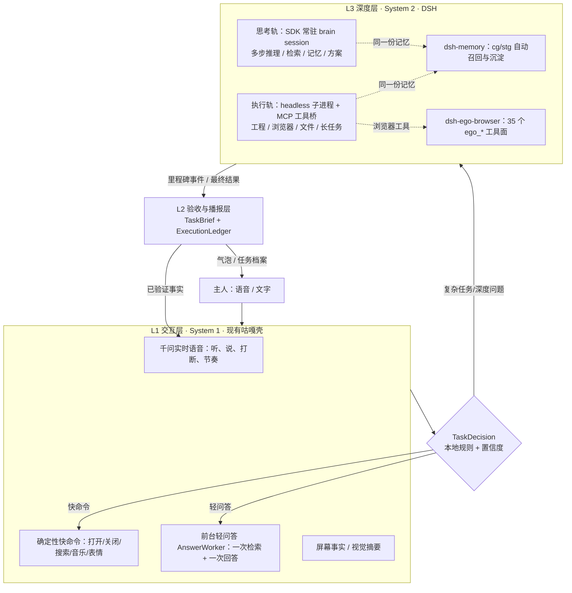

# 咕嘎 × DSH 深度思考引擎：等保结论与合并升级方案

日期：2026-11-04　｜　版本基线：咕嘎工作区源码（`bc2c4d6` + 未提交改动）、本机 DSH `0.2.1-rc.5`
性质：**探索/决策文档，未改任何源码、未改 DSH 全局配置、未调用付费模型**
证据：三份调研报告 + 一次官方 SDK 引擎握手实测（见附录 A）

---

## 0. 一句话结论

**可行，而且不是"能不能接"的问题——咕嘎已经完成了约六成接入。** 现在真正要做的，是把 DSH 从「按任务启动的一次性执行器」升级为「常驻、有记忆、能用浏览器、语音可见的深度思考引擎」；咕嘎则从「什么都自己干的助手」重新定位为「总指挥 + 语音壳 + 验收层」。

**推荐路线**：`headless 执行轨`（现状保留）+ `SDK 常驻思考轨`（新增）+ `dsh-memory 共享记忆` + `dsh-ego-browser 浏览器工具面`；superagent 只吸收设计纪律，不装代码；不升级 0.2.2-alpha，不 attach 用户 Web GUI。

**投入估计**：P0 1–2 天、P1 2–3 天、P2 3–5 天、P3 3–5 天；P0+P1 即可验收「你作为深度决策层」的最小闭环，P2 起才是常驻第二大脑。

---

## 1. 判断依据：现状与实测事实

### 1.1 咕嘎侧（真实运行证据）

| 事实 | 证据 |
|---|---|
| 已有 DSH 集成，但形态是「单飞、按任务、一次性子进程」 | `core/dsh_worker.py:43-44`（单飞拒绝并发）、`:24`（单一 `self.state`）、`:148-248`（一进程=一轮） |
| 真实跑过 7 张工单 / 47 条工具回执；时长 9.3–128.4 秒 | `runtime/chat/personal-harness.sqlite3`；「开浏览器」43.5s、西瓜图任务 128.4s |
| 路由本地优先：只有代码工程/显式点名才走 DSH | `core/task_router.py:73-90` |
| 路由被算两次，且语音/文字入口不同 | `ui/agent_chat.py:447` 与 `:1237` 重复调用 `choose_task_route` |
| `thinking` 事件被主动丢弃；进度只有 30 秒心跳 | `core/dsh_worker.py:141`；`core/task_brief.py:157` |
| 没有 conversation→DSH session 稳定映射，没有 call_id→job 的 trace | `core/dsh_worker.py:50-52,64`；`ui/agent_chat.py:1263-1271` |
| 语音壳：千问端到端实时语音 + 5 个原生 FC 工具；首音频实测约 1094ms | `core/realtime_agent.py:16-67,270-276`；`docs/technical-capability-boundaries-20261104.md:260-262` |
| 本地浏览器是「表单型自动化」（ref/幂等/回读），不是视觉型 browser-use；无截图回传、无 JS 读取 | `core/browser_session.py:112-157` |
| 成员记忆是 SQLite 轻量打分，不是向量库；显式规则抽取 | `core/agent_memory.py:189-211` |
| 顺带发现：`requirements.txt` 缺 `psutil`（新机启动即崩）；`mcp_servers.json` 不存在（生态 MCP 实际不可用） | `core/bg_shadow.py:4`；`core/mcp_host.py:100-109` |

### 1.2 DSH 侧（安装版实测）

| 事实 | 证据 |
|---|---|
| 五个程序化入口：`headless` / `sdk` / `sdk-minimal` / `acp` / `web`，都是 profile 组合 | `dsh --help`；CLI README |
| headless：一次任务、`--json` NDJSON、`--session-id` 续接、退出码 0 仅当最后 `turn/end` 完成；**无取消通道**（杀进程） | 安装版 `dsh --profile headless --help`；`dsh-headless` README |
| headless 进程启动开销实测 **2.6–2.7 秒/次**；NDJSON 事件：`session/status/thinking/text/tool_call/tool_result/final/error`，`text` 非逐 token | 本机实测 |
| **SDK 常驻引擎已实测可由 Python 直接驱动**：`initialize` 3188ms（含冷启动）、`session/working-directory/get` 16ms、`shutdown` 干净退出 0 | 本次探针 `runtime/research/upgrade-20261104/sdk-handshake-probe.json` |
| SDK 协议：JSON-RPC/stdio，多会话、`session/prompt|query|resume|wait`、审批、原生问答、事件流；**无 cancel / close session 方法**，放弃=关进程 | `dsh-sdk-protocol` 类型；SDK server README |
| ACP：标准协议，多会话、`session/cancel` 停稳式取消、跨进程 list/resume/close；适合语音「停止/打断」 | `dsh-acp` README |
| 安装版 **未随包发布官方 browser-use 子系统**（Playwright MCP / Chrome DevTools MCP / Stagehand 只在 0.2.2-alpha 源码中） | `node_modules` 无 `dsh-browser-use`；checkout 版本实际是 `0.2.2-alpha.2` |
| Python SDK 已在 PyPI：`deepseek-harness-sdk` 最新 `0.2.1rc2`（MIT，带同版本 runtime wheel）；本机未安装 | PyPI JSON；`pip list` |
| 已装插件：`dsh-ego-browser@0.9.9`（ego-lite，35 个 `ego_*` 工具，headless 工具面可用、观察窗自动 no-op）、`@furongjun1999/dsh-memory@0.9.22`（灵枢，纯 `inject=['tools']`，默认只暴露 `cg`/`stg`，headless 可加载） | 两插件 `dsh-plugin.json`/`lib/index.js`；本机 `python -c "import md_cg"` 成功 |
| 记忆数据根：`MDCG_STATE_ROOT` → `$DSH_HOME/.dsh-memory` → `~/.dsh/.dsh-memory`；真源是 `~/.dsh/.dsh-memory/data/mdcg/**` 纯 md | `lib/lib/datapath.js:104-119,351+`；本机数据目录 |
| 本机 headless profile 已配好 OpenCode Go 路由（`llm-pi-ai`，`opencode-go/deepseek-v4.1-flash`，reasoning high） | `~/.dsh/profiles/headless/cordis.patch.yml`；`dsh-llm-pi-ai` 已随安装包存在 |

### 1.3 外部项目定位（必须纠正的表述）

| 说法 | 事实 | 结论 |
|---|---|---|
| 「super agent 这个官方开源项目」 | `deepseek-ai/dsh-superagent-prototype` 确实在官方组织、MIT，但 README 原文写明「Research prototype for reference only, **not an official DeepSeek product**」，无 release/tag，文章部分设计未实现 | 应表述为「DSH 官方团队的**研究原型/设计文章**」；吸收设计，不装代码 |
| 「browse use」 | `browser-use` 是自带 agent loop 的 Python 浏览器库（按索引点击）；ego-browser 是 `CitroLabs/ego-lite` 的 DSH 工具化封装（35 工具 + 观察窗/人工接管/任务空间）。**无公开证据显示 ego-browser 借鉴 browser-use** | 保留 ego-browser，不引入 browser-use 依赖 |
| 「dsh memory 插件」 | 第三方 `@furongjun1999/dsh-memory`（符荣峻，MIT），非 DeepSeek 官方；主推 stdio MCP 直挂，插件是包装层 | 可用，但按第三方组件管理版本与体积（约 27MB/1830 文件） |
| 「官方 dsh 作为深度思考引擎」 | 正确：headless / SDK / ACP 都是官方一等公民的程序化入口 | 直接用，不 fork、不魔改内核 |

---

## 2. 目标架构：三层 + 双轨



**职责边界（一句话版）**：
- **咕嘎壳**：听得清、答得快、随时打断、只播报已验证事实、守住停止/确认/权限。
- **DSH**：想得深、做得久、会查会读会操作、记忆持续沉淀；它的隐藏推理永远不直接进语音。
- **TaskDecision**：把「这句话」翻译成一张工单（目标/验收/预算/执行器/会话），是唯一的调度真值点。

**双轨参照**：`deepseek-harness-orb` 的「前台可见交互 / 后台 Session 派发、Stop 只停当前轨」与 superagent 的「Main Session / Executor Session」是同一思路，适合咕嘎（但它 Electron 进程内实现，不可直接移植）。

---

## 3. 五个关键决策（含证据）

### D1 传输协议怎么选

| 模式 | 用途 | 优点 | 硬伤 | 结论 |
|---|---|---|---|---|
| **headless one-shot + session-id**（现状） | 长任务执行轨 | 官方一等公民、无端口无残留、退出码清晰、取消=杀进程 | 每次 2.6–2.7s 启动；单任务；无中途追问 | **保留**，作为执行轨 |
| **SDK 常驻 JSON-RPC** | 深度思考轨 | Python 可直接驱动（已实测）；多会话、事件流、审批/问答；热请求开销 16ms 级 | 无 cancel；进程崩全丢；stdout 纯度要求 | **新增**，作为思考轨首选 |
| **ACP 常驻** | 需强取消/多客户端时 | 标准协议；`session/cancel`；list/resume/close | 需 ACP 客户端；只标准面 | **P3 备选**，语音停止要求高时切换 |
| Web HTTP/WS 附着 | 旁路复用 GUI | 同机最低延迟 | 无公开自动化契约、token/Typert 私有、升级易碎、污染用户会话 | **不做** |
| 反向 DSH 插件/MCP 桥 | 工具回灌（现状） | 工具/权限/会话都在 DSH 内 | 需 Node/Cordis，产品化后期 | 保留现有 `dsh-mcp-client` 桥，不扩大 |

**推荐**：执行轨=headless，思考轨=SDK；两者共享 `TaskDecision` 与 ticket 档案。不要把所有任务都塞进常驻进程——一条长任务崩溃会带走整个脑；也不要全用 headless——每次 2.6s 冷启动撑不起「深度思考层」的交互感。

### D2 会话与工单

- **conversation → session 稳定映射**：每个成员（001/002/003）一个常驻 brain session id，存 `personal_harness`；每个 DSH 长任务一个 session，`ticket` 里存 `call_id / trace_id / session_id / first_event_at / first_report_at`。
- **Ticket 生命周期独立于 Session**（superagent 原则）：Session 可换（崩溃/换执行器），Ticket 状态机不变。
- **续接**：brain 用 `session/resume`；长任务用 `--session-id`。两者都要求同 cwd/同 preset，升级前先跑兼容回归。

### D3 记忆：一份真源，先别双写

| 方案 | 做法 | 风险 | 建议 |
|---|---|---|---|
| v1（推荐） | DSH 侧装 `dsh-memory`；给 headless/SDK 子进程设 `MDCG_STATE_ROOT=~/.dsh/.dsh-memory`（或 `MDCG_ROOT=~/.dsh/.dsh-memory/data/mdcg`），与用户 Web 会话共享同一 md 真源 | 记忆会进入 DSH 会话上下文，增加 token/延迟；memory 默认 `tools:'core'` 只开 `cg`/`stg`，收敛 | **先做** |
| v2 | 咕嘎用现有 MCP host 直挂 `python -m md_cg.mcp_server`，给自己的前台问答做只读召回 | 两个宿主并发写同一 md 库有锁竞争；包体大 | 评估后再做 |
| v3 | 继续只用咕嘎 SQLite | 与 DSH 记忆各一套，长期分家 | 不推荐 |

**关键坑**：记忆根随 `DSH_HOME` 变化。咕嘎冻结版把 `DSH_HOME` 指向 `runtime/dsh-home`，不设 env 就会开一个空库 → 必须显式 `MDCG_STATE_ROOT`/`MDCG_ROOT`。

### D4 浏览器：用 ego-browser 的工具面，不重造浏览器

- **路由**：打开/关闭/单表单 → 咕嘎本地快路径（秒级、不抢焦点）；登录态、验证码、多标签、多页流程、下载、读取动态页 → DSH + `ego_*`（35 个工具）。
- **headless 可用性**：插件 `inject=['tools','subprocess']`，无 `webServer` 时观察窗/推流自动 no-op；**只丧失观察窗，不丧失工具**。建议 patch 里 `disableFrameRelay: true`；浏览器本体在 Windows 桌面通常会真实启动，用户可直接接管（待实测确认）。
- **单输入 owner**：ego 与咕嘎 `browser_session` 是两套独立浏览器/profile。同一时刻只允许一个执行器操作浏览器（沿用单飞锁 + 新增 browser owner 标记），避免两个 agent 抢标签。
- **不升级 0.2.2-alpha 换官方 browser-use**：alpha 风险 + 安装版 CLI 未随包发布；ego-browser 已有观察窗/人工接管/任务空间/登录态，正好补咕嘎最缺的「用户可介入」。

### D5 superagent：吸收 6 条纪律，不搬 5 样东西

**吸收**：
1. 注意力预算：只在「人必须行动」或「结果可用」时开口（咕嘎已在做，写成硬规则）。
2. Policy 版本化：权限/白名单变更要记录版本，恢复任务前重验证。
3. Gate（确定性准入）+ Assessment（模型研判）两层判定：确定性规则永远先跑，模型只做建议。
4. Ticket 独立于 Session / Executor 可换。
5. `observe → auto` 灰度：新任务类型先「只记录/只建议」，稳定后再自动执行。
6. stored-work / worker-slot：任务先落盘再执行、失败退避、桌面同一时刻一个输入 owner、给人消息留一条通道。

**不吸收**：完整 Mandate/Assignment/Subscription 域模型（单用户桌宠过度设计）、GitHub/飞书 Source、多人允许名单/跨 Source 身份映射、进程内 DSH bundle 实现（Python 进程无法直接移植）、团队合规面板。

---

## 4. 语音智能体合并升级（这次怎么"合"）

### 4.1 时延与预算

| 阶段 | 预算 | 现状/依据 |
|---|---|---|
| 首音频（S1） | ≤1.1s | 实测约 1094ms（`docs/technical-capability-boundaries-20261104.md:262`） |
| 受理回执 | ≤1s | Qwen 先短答，工具结果可后补 |
| 深度任务首条播报 | ≤5s | 新增：`turn_start` 即播报一次，30s 心跳兜底 |
| 进度播报 | 30s/次 | 现有 `task_brief.py:157` |
| 用户说「停」→ 停止后续动作 | ≤2s（确认后） | 现有二次确认 + `taskkill /T /F`；SDK 轨需设计 |

### 4.2 路由策略（唯一真值点）

```
这句话 →
  ① 快命令命中？            → 本地白名单执行器（<100ms）
  ② 闲聊/情绪/已有事实？     → 千问直接说（不落任务）
  ③ 轻知识问题？            → AnswerWorker（一次检索+一次回答，5–20s）
  ④ 需要多步推理/多来源/规划/记忆检索/浏览器？
       → DSH 思考轨（brain session）→ 里程碑播报 → 最终结论
  ⑤ 需要真实操作/长工程？
       → DSH 执行轨（headless + MCP 工具桥）→ TaskBrief → 验收
```
规则 ④ 是这次新增的「深度思考层」入口；规则 ⑤ 是现有执行轨。两者共用 `TaskDecision`，禁止在 `ui/agent_chat.py` 的两处重复计算。

### 4.3 打断/停止语义（保持现有正确设计，别改坏）

- `interrupt()` = 停播报 + 废弃未完成工具调用，**不取消后台任务**（`core/realtime_agent.py:322-330`）。
- 只有明确「停止」+ 二次确认才 `dsh.stop()`（`ui/agent_chat.py:548-552,956-963`）。
- 新增：思考轨停止 = 关闭/重启 SDK 进程（或 P3 切 ACP `session/cancel`）；已发出的外部操作不回滚，如实说明。

### 4.4 播报纪律

- 只播报**已验证回执**；`thinking` 永远不播（当前丢弃是正确的隐私选择，保留）。
- 一次只问一个结构化问题；needs_input 不重复催问。
- 失败按「已确认什么 / 缺什么证据 / 下一步」说人话，不把「连接失败」冒充「页面失败」。

### 4.5 可观测性（新增）

`runtime/voice/trace.jsonl`：`call_id → decision → executor → job_id/session_id → first_event_at → first_report_at → final_at`，按 P50/P95 统计首响、路由耗时、失败率。这是 P0 就该补的地基。

---

## 5. 分阶段落地计划

### P0 · 修地基（1–2 天，S/M，风险低）

| # | 改动 | 位置 |
|---|---|---|
| 1 | 合并重复路由，抽出 `TaskDecision`（纯函数 + 可插拔顾问） | `core/task_router.py`、`ui/agent_chat.py:447,1237` |
| 2 | `DshManager` 单 `state` → `jobs{}` + per-job 锁 + `trace_id/call_id` | `core/dsh_worker.py:24-26,43-44,94-96` |
| 3 | 去掉 PowerShell 包装（源码态直接 spawn node/dsh），事件首达即播报一次 | `core/dsh_worker.py:148-181`、`ui/agent_chat.py:776-812` |
| 4 | patch 文件清理（>7 天/按会话复用）；解析 `usage` 事件 | `core/dsh_worker.py:113-125` |
| 5 | 补 `psutil` 到 requirements；决定 `mcp_servers.json` 提供或删除 | `requirements.txt`、`mcp_servers.example.json` |
| 6 | 统一「完成判据」：`returncode==0 && final.reason.kind=='completed' && 无 blockers`（已有，补测试） | `core/dsh_worker.py:219-231` |

**验收**：现有 7 张工单可重放；「开浏览器」不再走 DSH（本地秒级）；DSH 任务首条播报 ≤5s；`trace.jsonl` 能还原一句话到一次执行。

### P1 · 深度决策短通道（2–3 天，M）

- `DshManager.advise(question, conversation_id, budget≈30–60s)`：一次性 headless 短任务，**不占 busy、不建 awaiting_review ticket**，只回一条 `dsh_advice` 事件。
- `TaskDecision` 在低置信/高风险时咨询它，超时（6–8s）回落启发式；语音先确认「我先判断一下」，再继续。
- 这是「你作为深度思考决策层」的最小闭环：不改变现有执行链，只补一个"分诊"能力。

**验收**：歧义指令（「把那个东西整理一下」）能给出 1–2 个候选并追问，而不是直接瞎跑；advisor 不可用时整体不变慢。

### P2 · 常驻深度脑（3–5 天，L）

1. **新建独立 profile**（不动用户 web profile）：`dsh --profile guga --from-default-profile sdk`（或直接初始化 sdk），在 `~/.dsh/profiles/guga/cordis.patch.yml` 补 `llm-pi-ai`（复制 headless 的 opencode-go 段）+ `agent-default-model`；再 `dsh plugin --profile guga add dsh-ego-browser@0.9.9 @furongjun1999/dsh-memory`（联网安装；也可用 `--patch` 先在 headless 验证再固化）。
2. **Python 侧 JSON-RPC 客户端**（约 200–300 行）：`initialize / session/query / session/event / session/status / session/wait / session/working-directory / shutdown`；先手写，后续再评估官方 `deepseek-harness-sdk`（本机未装，PyPI 有 0.2.1rc2）。
3. **每个成员一个 brain session**：深度问答、方案对比、多步检索、记忆召回；里程碑事件经 `TaskBrief` 投影成 1–2 句语音；最终结果进气泡和长期记忆。
4. **冷启动管理**：引擎进程常驻（空闲回收 10–30 分钟），首次 3–4s 预热；语音首次深度请求先播「让本鹅认真想想」。

**验收**：多轮深度问答保持上下文（重启后 `session/resume` 成功）；热请求协议开销 <100ms；引擎崩了能自动重启并降级到 AnswerWorker；不阻塞首音频。

### P3 · 记忆 + 浏览器（3–5 天，M/L）

- 共享记忆根（`MDCG_STATE_ROOT`）；DSH 任务自动召回/沉淀；给咕嘎前台问答加只读 `cg(op=route)` 召回。
- ego-browser 工具面接入：复杂浏览器任务路由、`disableFrameRelay:true`、单 owner 锁、人工接管说明。
- 浏览器验收闭环：打开 → 读快照 → 填/点 → 回读 → 截图/下载回执。

**验收**：两个连续任务不抢同一标签；登录态/验证码场景有明确人工接管提示；记忆在 Web 会话与后台任务之间一致。

### P4 · superagent 化 + 产品化（按需）

- Ticket 状态机扩展（Policy 版本、observe→auto、stored-work 队列、worker slot）。
- 打包：vendor 里增加 `profiles/guga` 与插件；重建 EXE；可观测面板（只显示需要人的事项）。
- 升级策略：跟随 DSH RC/stable，不追 alpha；每次升级先跑 headless/ACP 事件兼容回归。

---

## 6. 风险与边界

| 风险 | 说明 | 对策 |
|---|---|---|
| DSH 仍是 developer preview | headless 事件无版本化 schema，字段可能变 | 事件映射层集中在一个文件 + 契约测试；升级前跑兼容回归 |
| 双执行器抢桌面/抢浏览器 | 咕嘎 SelfAgent + DSH 同时操作同一窗口 | 单飞锁 + browser owner 标记 + 「同一时刻一个输入 owner」 |
| 记忆分家/并发写 | `DSH_HOME` 不同会开空库；两个进程同写 md 库 | P0 就固定 `MDCG_STATE_ROOT`；v1 只让 DSH 写、咕嘎读快照 |
| SDK 无 cancel | 语音说停只能杀进程 | 短思考用 SDK、长任务用 headless（可杀）；P3 评估 ACP |
| ego-browser Windows 运行时实验性 | 社区移植，端口/profile 锁问题 | 失败回退咕嘎现有浏览器 + 明确报错，不假装成功 |
| 成本上升 | 深度任务内部多次模型调用 | 每任务预算上限 + `usage` 埋点 + Go 套餐额度保护 |
| 权限/安全 | full access + DSH 工具 + approval never | 分级授权（只读/可逆/对外/不可逆）；不可逆动作仍要确认；不因换执行器扩大权限 |
| 打包体积 | vendor 增加 node/dsh/profile/插件 | 按需裁剪；记忆/浏览器插件可选安装 |

---

## 7. 验收口径（最小场景，逐条可测）

1. **深度问答**：语音「帮我查三个来源比较 XXX，给结论」→ 思考轨多步检索 → 30s 内有进展播报 → 结论带来源。
2. **浏览器执行**：语音「把这个网页的表格整理成 Excel」→ DSH+ego 打开/读取/下载/回读 → 文件落盘可复核。
3. **中断**：执行中说「停」→ 二次确认 → 2s 内不再有后续动作；已完成的副作用如实说明。
4. **记忆**：问「上次我说的报告偏好」→ 召回 1–3 条带出处的记忆，不编造。
5. **失败**：断网/无 key/DSH 崩溃 → 如实播报并降级本地，不把失败说成完成。
6. **重启**：重启咕嘎后能恢复任务档案；会话可续接；不重放已发送的点击/消息。

---

## 8. 明确结论与建议

1. **结论**：可行，且不需要重写咕嘎、也不需要魔改 DSH。官方三种程序化入口（headless/SDK/ACP）+ 两个已装插件（ego-browser、memory）已经覆盖用户提出的全部诉求；真正的工程量在「会话状态、记忆共享、浏览器归属、语音调度」四件事上。
2. **现在就该做**：P0（修地基）+ P1（深度决策短通道）。这两步不改 DSH 全局配置，只动咕嘎源码，一周内可验收。
3. **P2 需要你点头**：会新建一个 `guga` DSH profile 并安装两个插件（写 `~/.dsh`，约几十 MB，不动你现有的 web profile）。
4. **不建议**：升级到 0.2.2-alpha 换官方 browser-use（alpha 风险）；附着用户 Web GUI 的 HTTP/WS；把 superagent 原型当依赖安装；让 DSH 直接拥有语音输出（应继续由千问壳统一播报）。
5. **一句话定位**：咕嘎是「总指挥 + 嘴 + 手 + 验收官」，DSH 是「深度思考 + 长任务执行」的第二大脑；两者用 TaskDecision、Ticket、Trace 三条线缝合。

---

## 附录 A：证据索引

| 文件 | 内容 |
|---|---|
| `runtime/research/upgrade-20261104/dsh-capability-map.md` | DSH 五种模式、插件机制、ego-browser/memory/superagent、六种集成模式对比（205 行） |
| `runtime/research/upgrade-20261104/guga-current-state.md` | 咕嘎现状、真实运行证据、12 个改造点、文档/代码不一致清单（255 行） |
| `runtime/research/upgrade-20261104/external-evidence.md` | superagent/browser-use/DSH 生态/语音慢思考外部核验（150 行，带 URL 与证据等级） |
| `runtime/research/upgrade-20261104/sdk-handshake-probe.py` / `.json` | 本次实测：安装版 DSH `sdk` 常驻引擎经 Python JSON-RPC 握手成功（0 次模型调用） |

关键本机证据：
- `~/.dsh/profiles/headless/cordis.patch.yml`：opencode-go 路由已配好，可复制给 sdk/guga profile。
- `~/.dsh/profiles/web/node_modules/dsh-ego-browser`：35 个 `ego_*` 工具、`inject=['tools','subprocess']`、headless 工具面可用。
- `~/.dsh/profiles/web/node_modules/@furongjun1999/dsh-memory`：`inject=['tools']`、`md_cg/mcp_server.py`、数据根 `~/.dsh/.dsh-memory`。
- `core/dsh_worker.py`、`core/task_router.py`、`ui/agent_chat.py`、`core/realtime_agent.py`：改造接缝（行号见正文）。
