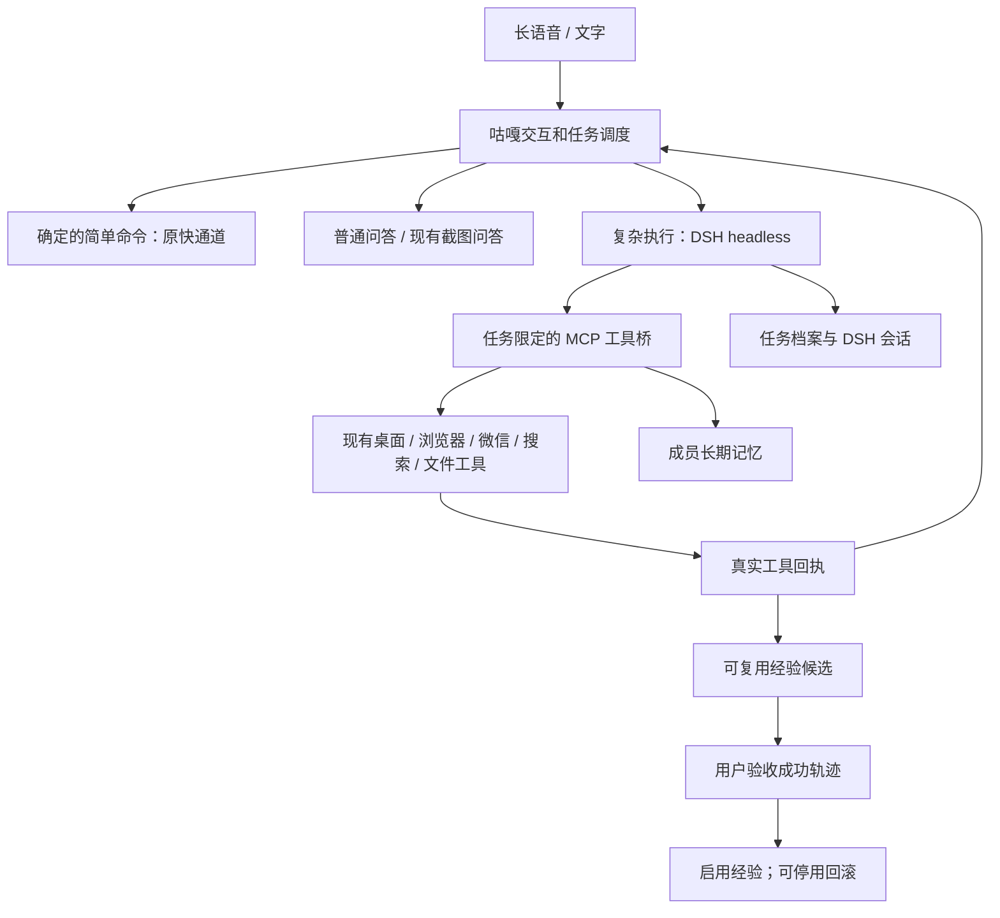

# DSH 驱动的个人咕嘎：2026-11-02 改造

版本标识：2026-11-02.dsh-personal.1。

## 这次真正改变的是什么

原来是 SelfAgent 自己执行，偶尔由模型选择 dsh_task。现在：已经命中的简单指令继续本地执行；其余执行任务默认启动真正的 DSH headless 进程。日常无工具问答仍由轻量回答器处理，带截图的直接提问保留现有视觉路径。

DSH 使用现有 Go 套餐模型配置和项目凭据，不经过本地 API 映射，也不把密钥写入源码、记忆或报告。全局 DSH Web 配置未修改。

## 下载与参考源码

- DeepSeek Harness 团队研究原型：https://github.com/deepseek-ai/dsh-superagent-prototype
- 本地：runtime/research/dsh-superagent-prototype。
- 固定提交：6337fc823ce20251c8de8085948165c81aaa701e（2026-10-31）。
- README 明确表示这是研究原型，不是正式 DeepSeek 产品，部分设计仍属于未来方向。
- 复核了任务状态分类、持久 worker 会话、执行目录、输入交接、中断恢复和报告机制。
- 淋雨家工作台：runtime/research/luanyujia-workbench，3b1ed2217ca3e016d7f0a73f98c620f9124f1445。

本次适配的是这些机制，不是原封不动安装 GitHub/飞书机器人。运行时真正使用本机 @deepseek-ai/dsh 0.2.1-rc.5；没有安装研究原型声明的 alpha 依赖或替换现有外壳。

## 当前架构

## 具体实现

- core/personal_harness.py：SQLite 任务档案、恢复状态、追加要求和经验候选。运行中崩溃后标为 interrupted，不自动重放点击或发送。
- core/dsh_worker.py：每个任务启动 DSH、传入身份和检索记忆、处理会话与事件。以“继续/接着/恢复上个”开头时尝试续接当前成员、当前对话最近的 DSH 会话。
- 每次任务专用 --patch 配置，挂载真正的 @deepseek-ai/dsh-mcp-client；全局 DSH 配置保持原样。
- core/dsh_tools.py：DSH 调用咕嘎已调好的桌面、微信、浏览器、搜索和文件执行器；保留观察 ID、微信发送去重、权限检查与结果核验账本。
- 工具调用放在工作线程，Qt 主线程只处理原有界面能力和响应，避免长命令直接卡界面。
- 工具桥只接受当前活动任务的调用。任务停止后不再接受该任务的新工具请求。
- 工具回执返回气泡/任务反馈；隐藏推理和原始敏感输出不用于进度播报。
- ready 表示交付待验收；失败、阻塞和未复查输入不能被当成验证成功。
- 确认停止时会停止 DSH 进程树并设置工具取消标志。已发出的输入不能撤销，已有软件的处理也可能需要完成当前不可中断调用后才释放。

## 可以直接使用的指令

- 打开浏览器 / 打开哔哩哔哩：沿用快通道。
- 搜索三个来源，整理成报告，写入指定文件并核对：DSH 执行。
- 继续上个任务：尝试续接上一个 DSH 会话，先核对现状。
- 停止任务 → 停止：沿用确认流程，确认后取消。
- 记住：我喜欢简短的中文项目报告：本地保存明确偏好。
- 查看我的记忆 / 忘记记忆 编号：查看与删除记忆。
- 查看长任务：查看持久任务状态。
- 确认上个任务完成 / 上个任务验收失败：记录实际验收结果。
- 查看学习经验 / 停用经验 完整编号：查看候选和停用已启用经验。
- 切换到旧执行器 / 切换到DSH执行器：下一条任务使用兼容路径或 DSH。

追加要求会先持久保存，在当前 headless 轮结束后另起续接轮处理。没有伪称运行中的 headless CLI 支持随时插入文本。确认停止后不自动执行已保存的追加要求。

## 自我改进与长期记忆的实际边界

本版本支持持久偏好、跨对话召回、任务检查点、DSH 会话续接、经验候选和人工验收后的经验启用。经验只是可复用操作建议，不是可任意执行的插件代码；可以停用。

本版本没有训练模型权重，也没有实现无人值守自动生成代码、自动跑隔离回归再自动发布的软件改造流水线。用户验收成功且存在成功工具回执，才允许候选经验启用；这也不代表经验在所有软件和任务里都有效。

现有 UIA、微信目标与发送验证等边界继续生效。Windows 权限继承应用实际权限，不会因为 DSH 启动就获得更高权限。图像问答仍走现有兼容路径；DSH 可以通过 computer.observe 获取当前屏幕。

## 验证证据

- 139 项相关离线和 Qt 集成回归通过，覆盖快通道、语音委托、停止确认、原音乐表情功能、记忆、任务恢复、工具桥、DSH 完成后 UI 释放。
- 真实 DSH 两轮隔离验收通过：第一轮通过 MCP 召回偏好、读取源文件、写报告并回读，保存经验候选；第二轮在同一个 DSH session 续接并回读。
- 第一轮 3 条文件工具成功回执；第二轮 1 条文件读取回执。
- 宿主独立核对生成文件包含 SOURCE_MARKER_7419 和测试记忆标记。
- 证据：runtime/personal-harness-probe/20261102-131632/result.json。
- 两轮 DSH 任务使用 Go 套餐，会有多次内部模型请求；没有调用千问语音 API。测试没有发送真实微信消息或对外发布内容。
- 本轮没有替用户进行真实麦克风长通话验收，没有重打包已有 EXE。

## 备份与回滚

修改前现状备份：runtime/upgrades/dsh-personal-20261102-130836/。保留了原工作区已有修改，没有 git reset，也没有覆盖个人模型配置。

功能回退可先说“切换到旧执行器”。源码回滚使用 tools/rollback_personal_harness.ps1；先关闭咕嘎，再运行。该脚本只恢复此次备份的既有文件，新增研究资料与工具保留，不删除任务数据。

## 许可说明

DeepSeek 官方研究原型采用 MIT：Copyright (c) 2026 DeepSeek Harness Team。许可证原文保留在下载仓库的 LICENSE 中。这里根据公开机制重写 Python 适配，未将整个原型打包为咕嘎产品。淋雨家工作台源码的许可证保留在其本地仓库 LICENSE 中。
