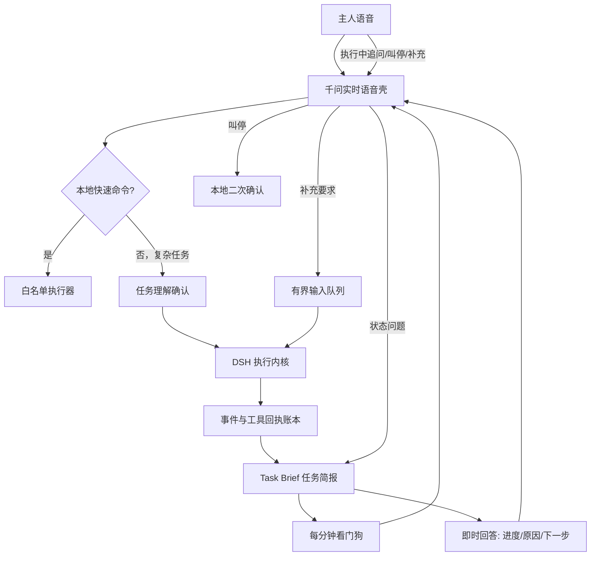

# 咕嘎语音外壳与 DSH 任务监督层

版本：`2026-11-02.dsh-supervisor.3`。升级前源码备份位于 `runtime/upgrades/confirm-progress-20261102-163351/`。

## 为什么以前像“不理人”

语音层收到任务后把控制权交给独立的 DSH 子进程，但以前没有一份随时可读的任务状态。用户问得稍偏离固定的“进度/进展”等词，请求就被当成追加要求，只回一句“当前操作结束后处理”。自动进度摘要的周期是 180 秒，而且连续没有新回执后不再报告。结果就是 DSH 在动，咕嘎看起来既不知道任务，也不给实质回应。

## 新分层

DSH 独占复杂任务的规划、工具选择、失败恢复和执行结果。咕嘎是任务总指挥与看门狗：负责听懂、确认目标、随时回答、接收停止和补充要求、监督回执、汇报真实进展。`Task Brief` 只把 DSH 事件整理成人能听懂的状态，不生成新计划，也不猜测成功。

## 响应路径

- 打开软件等白名单动作仍走本地快速路径。
- 复杂语音任务先复述目标并等待“确认执行”；取消时不会启动 DSH。
- 执行中的“做到哪、为什么卡住、下一步是什么、还要多久”直接读 DSH 简报，不再启一个新的模型规划任务。
- 普通闲聊可以直接由千问回答；涉及任务状态和实际操作必须进入本地状态或 DSH。
- 新补充要求进入有界队列，不会打断正在完成的鼠标或键盘动作。
- “停止”经过二次确认后终止当前 DSH，已经完成的外部操作不会谎称回滚。

## 看门狗

每 60 秒最多生成一条业务简报，内容来自 DSH 状态、`task_report` 和工具回执：

- 第几分钟；
- 已确认完成了什么；
- 最近一次真实操作；
- 明示卡点；
- 没有新回执时明确说“原因还不能确认”；
- 只要任务仍在运行，就不能说完成。

停留在 `needs_input` 时不再每分钟重复催问。用户说话时汇报延后，重要决定和完成消息保留更久。

## 桌面操作与视觉闭环

沿用现有 Windows 工具，并明确要求 DSH：先观察目标窗口，发一次点击/输入/拖拽，随后重新截图或读取控件核验；画面没有显示目标变化时不得报告成功。`computer.observe` 的截图会通过 MCP image block 返回模型。咕嘎还保留 UIA 结构化控件、Shell 启动和专用微信执行器，避免每件小事都依赖看图坐标。

这套职责拆法吸收了此前 DSH Computer Use、Super-agent/Orb 调研中的三点：前后台分离、事件账本、操作后重新观察；不移植另一套 Electron 窗口或额外模型外壳。

## 已验证与未验证

- 62 项相关自动检查通过，覆盖语音事件、复杂任务单次确认、停止确认、DSH 完成、等待决定、Edge TTS/实时语音播报、每 60 秒看门狗和真实 MCP 工具桥。
- 尚未完成真人长语音压力测试；网络抖动、声纹门限、千问模型自身的首包时延仍需实机观察。
- 已安装的 DSH 为开发者预览版，其事件格式变化时需要先跑兼容测试再升级。
- 本阶段修改源码运行版，未重建 EXE。
