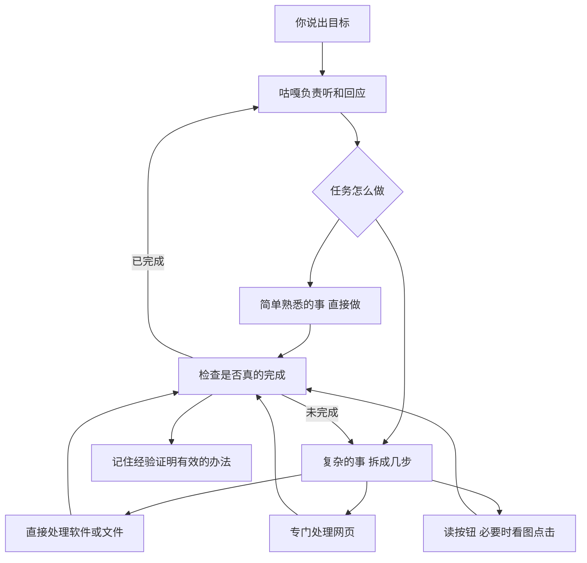

# 咕嘎成为电脑管家的路线调研

日期：2026-10-29。范围：读取本地代码、读取当前桌宠的状态、查阅公开项目文档。本轮没有改动功能代码，没有安装项目，没有修改权限，也没有调用付费模型测试。

## 结论

咕嘎已有电脑管家的基本部件：语音入口、理解任务的模型、打开软件的快捷办法、读取按钮、截图、键鼠输入、读写文件、运行命令、长任务助手。当前运行实例报告“完整访问开启、管理员身份”。

下一步主要工作是把这些部件组织得更可靠：先认清现状，选择合适的操作办法，记录任务做到哪里，确认结果，失败后能够换路。管理员身份不能自动解决这些问题。

## 现在怎样执行

1. 用户说话，由千问实时语音处理收听和回答。配置为 qwen-audio-3.1-realtime-plus。
2. 确定的简单指令，例如打开默认浏览器或熟悉的网站，先走本机快捷处理；不用每个动作都等待推理模型。
3. 更复杂的请求交给内层 DeepSeek，当前配置为 deepseek-v4.1-flash。模型选择本地工具，工具返回结果，再决定下一步。
4. 很长的任务可以交给另一个独立运行的 DSH 助手。源码中确有启动、状态回传和停止入口；本轮没有实测其任务质量。
5. 咕嘎再将实际结果通过语音、气泡或对话窗口反馈给用户。

模型主要在提供方服务器上理解和规划，本机程序负责实际执行。程序能截图并把截图交给模型，但这不等于一直共享实时画面。本轮未验证模型提供方对截图的实际理解效果。

对应代码：core/realtime_agent.py、core/fast_commands.py、core/self_agent.py、core/dsh_worker.py。

## 目前有哪些操作办法

| 办法 | 大白话解释 | 现状与边界 |
|---|---|---|
| 直接打开软件或网址 | 把软件地址、网址交给 Windows | 已有；已打开的软件会尝试复用已有窗口 |
| 读取和调用按钮 | 向 Windows 要一份软件的按钮清单，再操作指定按钮 | 已有；部分软件不提供清单，或提供得不完整 |
| 看截图、控制键鼠 | 像人一样定位和点击 | 已有；会受窗口位置、焦点、遮挡和页面变化影响 |
| 直接读写文件、运行命令 | 整理文件、批量处理数据时直接干活 | 已有；本机权限允许的范围内执行，部分写入带备份 |
| 特定软件专用流程 | 微信搜索对象、进入会话、填写正文、发送并回读 | 已有；这是打磨过的专项流程，不代表所有软件都有同样可靠性 |
| 网页内部的专用操作 | 直接读网页里的链接、输入框和正文 | 当前 browser_agent 主要还是打开浏览器、再观察窗口；通用网页专用控制仍有提升空间 |

对应代码：core/authorized_apps.py、core/computer_control.py、core/uia_backend.py、core/desktop_access.py、core/browser_agent.py、core/wechat_demo.py。

## 权限实际是什么

- 当前桌宠返回 full_access=true、administrator=true。这是对正在运行实例的读取，不是根据历史推测。
- “完整访问”是咕嘎自己的功能开关：允许本地工具工作。管理员身份是 Windows 给这个运行程序的身份，两者独立。
- 本地读写和命令能力没有限定只能在桌宠项目文件夹工作，具体仍取决于 Windows 的访问控制。
- 启动配置 run_as_admin=false，因此当前的管理员身份不等于换一种启动方式后仍会保持管理员。
- 管理员不是 Windows 本身，也不等于能访问一切受保护界面、任意软件内存或远程服务器数据。更高身份不能代替软件操作方法。
- 命令工具有每次最多 300 秒的预算；内层模型主循环目前最多 80 轮；DSH 入口另有单次时长范围。它们是当前实现的限制，需要做任务接续时应单独审视，不能假设任务会无限持续。

微软说明键鼠输入受目标权限等级限制：[SendInput](https://learn.microsoft.com/en-us/windows/win32/api/winuser/nf-winuser-sendinput)。受保护界面另有访问条件：[桌面辅助程序的权限](https://learn.microsoft.com/en-us/windows/win32/winauto/uiauto-securityoverview)。[LocalSystem](https://learn.microsoft.com/en-us/windows/win32/services/localsystem-account) 是另一种系统服务身份，不是普通管理员应用的同义词。

## 当前差距：判断与已证实事实分开

源码已提供工具选择、任务记录、结果检查和失败反馈，不能再把咕嘎描述成只有固定函数的聊天外壳。

但这些代码入口存在，并不能证明陌生软件和长任务已经稳定。以下是根据代码结构提出的升级判断，不是本轮实机失败统计：

- 通用操作经常需要多次往返模型，并且当前推理请求是等整次返回再继续。简单动作如果误进长任务，就会显得慢。
- 目前有“发出输入后再观察”的检查，但一次新的观察不一定足以证明业务目标实现。应给保存文件、消息发送、下载完成等分别定义明确的结果条件。
- 已有任务记录和恢复相关部件；仍需验证退出重开、窗口消失、任务中断等情况下能否正确接着做。
- 现有成功流程需要形成可复用的本机经验，并用改名字、换窗口大小等变化检验，避免只适配一次演示。
- 用户和助手共享同一套真实鼠标、键盘、前台窗口。后台计算可以同时做，多个任务同时操作同一个聊天框会互相干扰。

## 可借鉴的项目

以下描述来自项目文档；未在本机安装或验证，演示与自报成绩不等于咕嘎接入后的水平。

| 项目 | 做什么 | 对咕嘎的借鉴 |
|---|---|---|
| [微软 UFO](https://github.com/microsoft/UFO/tree/main/ufo) | 把 Windows 上跨软件的工作分给总管和各软件助手；混合使用按钮操作与软件自身提供的入口 | 作为整体组织方式的主要参考。部分桌面隔离功能文档仍标为开发中，不当作现成能力 |
| [Windows-MCP](https://github.com/CursorTouch/Windows-MCP) | 向模型提供 Windows 的窗口、按钮、截图和操作工具 | 参考统一的电脑操作工具和卡住处理；当前主线依赖与咕嘎现有 Python 环境不同，不能直接假设装入即可用 |
| [Browser Use](https://github.com/browser-use/browser-use) | 专门操作网页，可连接本地、云端或已有的兼容浏览器 | 让查资料、填表、读网页走专门办法；豆包浏览器是否开放所需连接入口尚未验证 |
| [UI-TARS / Agent TARS](https://github.com/bytedance/UI-TARS-desktop) | 看画面操作电脑，组合网页、终端及外部工具，保留过程事件 | 为没有按钮清单的软件补充视觉操作；学习让咕嘎及时知道工具正在做什么。需要合适模型和接入验证 |
| [Agent S4](https://github.com/simular-ai/Agent-S/tree/main/agent_s4) | 从任务经历中改进供智能体使用的操作工具，再在另外的任务上检验 | 借鉴“积累经历—改进工具—单独考试—保留有效改动”，不等于聊天几次就训练了 DeepSeek 本身 |
| [Hermes Agent](https://github.com/NousResearch/hermes-agent) | 长期助手，保存经历、检索历史、创建和改进做事方法 | 研究跨会话记忆和经验积累；它的学习能力不能直接当成 Windows 软件操作能力 |
| [OpenClaw](https://github.com/openclaw/openclaw) | 长期运行的个人助手，统一管理会话、工具、事件和多个交流入口 | 研究咕嘎外壳与后台工作如何解耦；本机运行不代表模型推理都在本机 |

参考原文：[UFO 分工与执行方式](https://raw.githubusercontent.com/microsoft/UFO/main/ufo/README.md)、[TARS 网页混合控制与事件记录](https://raw.githubusercontent.com/bytedance/UI-TARS-desktop/main/README.md)、[Agent S4 改进与验证过程](https://raw.githubusercontent.com/simular-ai/Agent-S/main/agent_s4/README.md)、[Hermes 学习与记忆](https://raw.githubusercontent.com/NousResearch/hermes-agent/main/README.md)、[OpenClaw 常驻结构](https://raw.githubusercontent.com/openclaw/openclaw/main/README.md)。

## 建议的整体样子

这是升级建议图，不表示所有环节已经达到可靠使用标准。

## 怎么推进最划算

第一阶段：保住快的基本动作。用打开默认浏览器、打开指定网站、微信搜索并填写消息、定位已打开的软件做一套固定考试。测试软件关闭/已打开/最小化、不同说法与窗口大小。分别记录从指令识别到开始执行、到完成的时间及成功率，不用单次演示代替稳定性。

第二阶段：打通一种完整的跨软件工作。比如搜资料、形成摘要、保存文件、在微信准备正文。任务目标和每一步结果要记录；中断后读记录和当前软件状态继续，避免重复发送。网页与文件应尽量用专用办法处理，不必逐个模拟点击。

第三阶段：形成经过考试的经验库。成功过程先保存为候选做法，在测试文件或测试账号中检查，再加入正式工具；软件更新导致旧方法不适用时可以停用或退回旧版本。先追求“做法变熟练”，不急着训练大模型本身。

需要长驻后台时，可以把显示咕嘎、收听用户与实际干活分开，让一个软件卡住不会连带整个桌宠失去响应；后台任务仍需有可见状态、停止入口和明确资源预算。这是后续实现建议，本轮未改成常驻系统服务。
