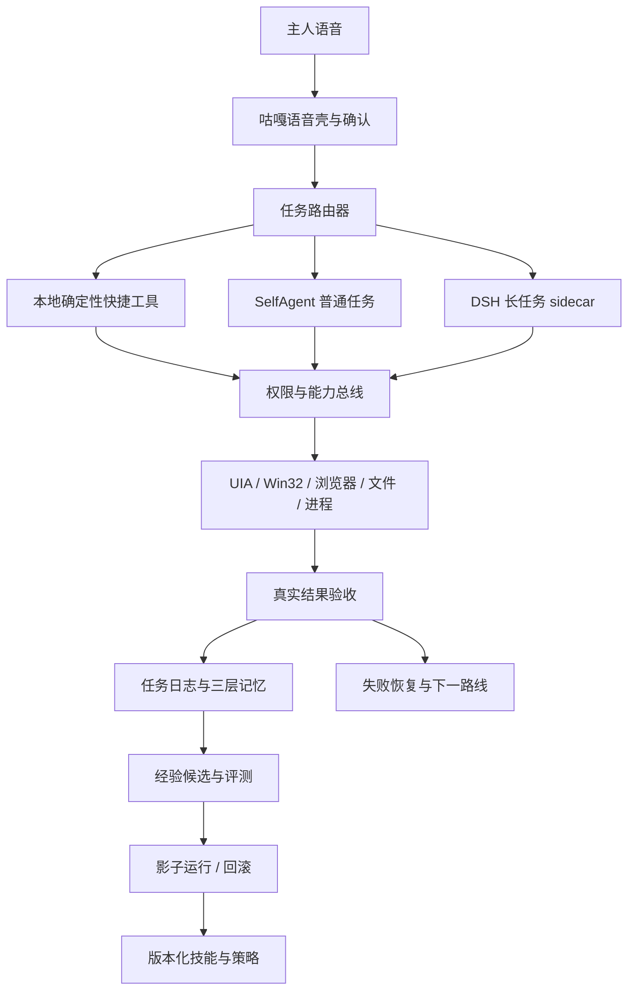

# 淋雨家工作台源码研究与咕嘎借鉴方案

调研快照：`mashanglinyu/luanyujia-workbench`，提交 `3b1ed2217ca3e016d7f0a73f98c620f9124f1445`（2026-11-01），MIT。

本地只读浅克隆：`runtime/research/luanyujia-workbench`。

## 先说结论

它不是一套可直接搬进咕嘎的“操作系统级自进化智能体”，而是一套以 DSH Web 为引擎的 Electron 多场景工作台。真正值得借鉴的是它把“场景身份、持久记忆、任务交接、权限、证据和回滚”做成了工作流程。

仓库包含公开可运行的壳和场景骨架，但作者明确说明路径、会话 id、MCP 与面板都要按本机重配；它不是装完即用产品。

## 已核验的代码事实

- 外壳是 Electron 43.4.0，`main.js` 约 264 KB，通过 `dsh web --no-open --port 3083` 启动外部 DSH。
- 壳与引擎分离：壳只通过本机 HTTP、启动日志解析的 token 和 IPC 认识引擎；数据目录通过 `DSH_HOME` 隔离。
- 场景配置是 JSON，包含面板布局和 AI 面板的 `sessionTitle`、`sessionId`、`pinTarget`。
- 公开版提供四个场景骨架：命令、B站、自我复盘、本地电脑。
- 记忆以本地文件为真源，提供 `场景记忆.mjs` 的 `list/init/stamp/交接/check`。
- 代码定义了“只读、写代码、同步”权限以及 `ask/auto/strict` 确认模式，写代码前会备份。
- 还有启动日志、健康状态、会话快照、GUI 回滚、发布前泄密扫描和 MIT 代码。
- 发布前红线检查实际运行通过，0 命中。
- 场景记忆检查显示公开骨架的四个场景都有私有记忆，但身份卡、画像、项目记忆和归档尚未初始化，印证了“模板需现场配置”。

## 哪些机制值得咕嘎吸收

### 1. 文件是记忆真源

聊天会话会压缩、切换或崩溃；任务结论和交接必须落到文件。咕嘎已有 SQLite 聊天记录和 `TaskJournal`，但还缺一个短小、固定格式、可检查的任务交接层。

建议增加三层：

- 每轮注入：只放主人授权边界和不可违反规则，必须极短。
- 任务私有记忆：当前目标、已完成、证据、下一步、卡点，建议上限 4 KB。
- 共享索引：项目、窗口、文件、工具、未完成任务和通知，按需读取。

不要保存完整聊天、截图、密钥或工具原始输出。只保存可核对的结论与路径。

### 2. 一个任务必须有固定身份

淋雨家工作台用三字段把面板钉到 DSH 会话。咕嘎的对应三字段应是：

```text
task_id        任务实体
conversation_id 对话实体
target_binding  目标窗口/项目目录/应用对象
```

这样能避免“当前窗口换了，模型还在对旧窗口操作”或把两个用户的微信聊天串在一起。绑定变化时必须重新观察，旧截图和旧 UIA 引用立即失效。

### 3. 决策、执行、验收、档案分层

咕嘎可以把职责固定为：

```text
调度器：理解目标、选择路线、请求确认
执行器：SelfAgent / DSH / 专项工具
验收器：读取真实回执，拒绝空口完成
档案器：写任务交接、经验候选和回滚点
```

不要为了“多智能体”让所有角色互相聊天。跨角色消息必须有上限，一条派单对应一条回执，并以证据结束。

### 4. 权限必须按能力分档

淋雨家壳展示了“读代码 / 写代码 / 同步 / 确认模式”的权限思路，但其公开版里仍有 full-access 会话。咕嘎目前也是全开或关闭的单一开关。

建议把 `full_access` 细化成：

| 能力 | 默认 | 说明 |
|---|---|---|
| 只读观察 | 允许 | 窗口清单、UIA、目标窗口截图 |
| 工作区写入 | 用户目录/指定项目 | 自动备份，限制越界 |
| 任意文件写入 | 需确认 | 展示具体路径和影响 |
| 启动进程 | 白名单 | 新软件首次需要确认 |
| 键鼠输入 | 前台绑定 | 只操作已观察且仍在焦点的对象 |
| 外部发送 | 每次确认 | 微信、邮件、上传、支付 |
| 系统设置/服务 | 最高档 | 单独确认、可回滚 |
| 自我修改 | 候选区 | 只能在沙箱/影子模式测试 |

### 5. 交接、快照、体检和回滚

升级前保留版本和配置；任务切换前写交接；改文件前备份；升级后跑健康检查；失败能恢复。咕嘎已有备份与任务日志，但应把“升级检查、任务交接检查和回归结果”统一成可执行的发布门。

### 6. 壳与引擎分开

咕嘎的语音外壳应负责用户关系和权限确认；DSH 负责长任务推理。两者通过明确事件和会话 id 连接，避免 DSH 升级直接影响桌宠 UI，也避免桌面输入与长任务互相抢状态。

## 不应直接照搬的部分

- 不照搬整套 Electron 工作台，咕嘎已有桌面宠物与对话壳。
- 不照搬场景中的固定路径、会话 id、客户脚本和本机运维命令。
- 不直接采用 full-access 默认权限。仓库自身也把“AI 可写任意路径”列为隐患。
- 代码是 MIT；仓库同时注明记忆方法论与内部实践文档另有版权，因此吸收机制时应重写实现和文档，不要整段复制受限内容。
- 该项目的“自我复盘”是场景，不是自动训练或自动修改系统。没有自动技能生成、离线评测、灰度激活和自动回滚闭环，不能把它描述成自进化系统。

## 咕嘎的操作系统级目标架构



## 受控自我进化闭环

真正的自我进化不能由主会话边干活边直接改正式技能。建议：

1. 记录成功轨迹、失败轨迹、结果证据和耗时。
2. 只把值得复用的过程生成“经验候选”，存入候选区。
3. 在隔离工作目录或影子模式重放测试任务。
4. 与现版本做 A/B 对比，必须同时检查成功率、误操作、耗时、权限越界和资源使用。
5. 通过门槛才发布新技能版本；旧版保留，可一键回滚。
6. 高风险工具、宪法规则和权限默认值不允许自动修改，只能提出建议等待主人批准。

## 推荐实施顺序

### 第一阶段：任务记忆与交接

- 给 `TaskJournal` 增加固定摘要：目标、状态、证据、下一步、卡点、目标绑定。
- 设置 4 KB/任务交接上限，历史自动归档。
- 完成结果只从工具回执生成，模型只能总结，不能伪造。

### 第二阶段：统一权限网关

- 把所有工具声明能力等级和目标范围。
- 前台输入前验证窗口、任务和用户确认。
- 外部发送、删除、进程启动和系统设置走独立确认。

### 第三阶段：DSH 专业执行器

- 保留 SelfAgent 处理短任务。
- 长任务才启动 DSH，并把 DSH 限制在项目工作区。
- 通过 MCP 暴露受控的窗口观察、UIA、文件读写和应用专项工具；不要直接把管理员键鼠权限交给任意长任务。

### 第四阶段：经验候选与评测

- 新增候选技能库、回归任务集、影子执行器和版本激活表。
- 优先积累浏览器、微信、文件整理、长任务恢复四类技能。
- 先不训练模型权重；先让工具、提示和流程可评测地进化。

### 第五阶段：隔离工作区

- 研究 Windows Agent Workspace、独立用户会话或 VM；高风险实验放到隔离桌面。
- 日常操作仍留在当前桌面，通过目标窗口绑定和权限网关约束。

## 现实边界

咕嘎当前距离“操作系统级自进化”缺的不是再多一层大模型，而是统一的权限、任务身份、可验证记忆、候选评测和回滚。先把这些基础设施做出来，再谈自动修改工具或技能。
