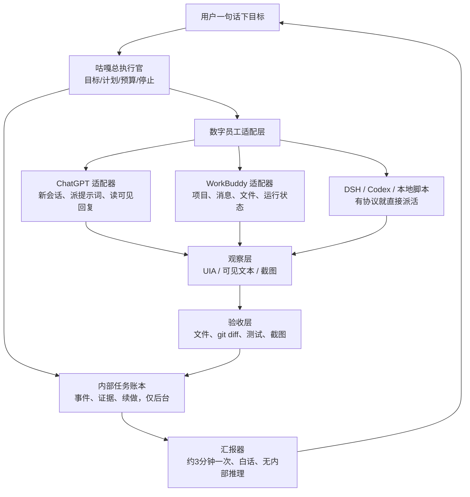

# 咕嘎总执行官方向讨论（2026-10-29）

## 已确认的版本事实

- 本机安装：`dsh 0.1.7-rc.2`。
- npm 当前 `latest`：`0.2.1-rc.2`。
- npm `next`：`0.2.1-rc.4`；`alpha`：`0.2.2-alpha.2`。
- DeepSeek Orb 快照使用的是 `0.2.1-alpha.2`，也比当前发布标签旧。DSH 尚处于 RC/预览阶段，使用“最新”时必须区分 `latest`、`next` 与 `alpha`，不能把“最新 alpha”当作稳定版本。

本机不是最新版；后续可以先在隔离测试中采用 `0.2.1-rc.2`，验证后再决定升级。不能直接下载 `0.2.2-alpha.2` 覆盖用户当前可工作的环境。

## 用户确定的原则

1. 任务流水账只在内部保存，用于恢复、核查和责任追踪；用户界面不显示工具流水、内部推理或思维链。
2. 不先做会话级权限界面。咕嘎的方向是操作系统级智能体，保留最高执行能力。
3. 咕嘎是总执行官，可以指挥外部智能体工作。典型场景是打开 ChatGPT，按用户目的新建对话并输入提示词，观察对方的可见回答与操作进度。
4. 长任务中约每三分钟汇报一次，用大白话说明已完成什么、正在做什么、哪里卡住、下一步是什么。只有有意义的变化、需要决定、真正停止或完成时才立即汇报。
5. 总验收是一个不需要长语音的文本任务：直接给咕嘎命令，让它全程操纵 WorkBuddy 完成一次简单开发任务。

用户不显示任务账本与隐藏思维链，完全合理。总执行官应该解释“发生了什么、为什么、下一步”，而不是把模型的草稿和工具 JSON 倒到界面里。

## 咕嘎要变成什么

用大白话说，目前咕嘎更像“会听口令、会动手的个人助理”；理想态是“能把工作分给别人的项目队长”。队长自己不必写每一行代码，但要会：

- 把用户目标拆成清楚的工单；
- 找到合适的数字员工并把工单交给它；
- 在对方工作时观察可见回答、修改文件和测试结果；
- 对方说做完了，仍要打开产物、跑测试并核实；
- 对方卡住时追问、纠偏或换人；
- 用几分钟一次的自然语言小结让用户知道项目真的在推进；
- 全程保留停止按钮、工作目录和预算边界。

这不是“再写一个大提示词”。它需要把主管、适配器、证据和汇报分开，否则外部智能体换个窗口、改变按钮或说一句“完成了”，咕嘎就会被带着跑。

## 推荐结构



这套结构中，四类职责不能混在一起：

- **主管**决定项目目标、任务顺序、何时追问、何时重试、何时换员工。
- **员工适配器**只负责操作某个软件或协议，例如给 ChatGPT 发消息、给 WorkBuddy 创建任务。
- **观察和验收**负责提供事实证据，不能把“员工文字上说完成”当作完成。
- **汇报器**从已验证事实里生成大白话总结，不展示原始事件流或思维链。

这与“长语音”是两层能力：文字输入就可以启动和监督；长语音只是移动双手、边听边说的入口。最终验收用文字通道完成，证明执行链路不依赖麦克风。

## 每张“工单”要写清楚什么

总执行官给外部智能体的任务不能只是“帮我做个东西”，而要像一张工作卡：

- 目标：要交付什么；
- 工作目录：文件允许写到哪里；
- 输入资料：参考文件、已有代码、约束；
- 产物：脚本、网页、文档、测试或修改后的项目；
- 验收：运行什么、看什么结果、检查哪些文件；
- 汇报节点：开始、关键里程碑、约3分钟进度、卡住、完成；
- 停止条件：重复失败、等待用户决定、超出预算、界面改变；
- 续做凭据：对应 ChatGPT 对话、WorkBuddy 项目或 DSH session id。

这张工单恰好解决“员工说做完了，但其实没做完”的问题。验收清单由咕嘎在派任务前确定，不能由员工自己临时定义。

## 每一轮监督怎么走

```text
用户目标
  -> 咕嘎写内部计划与验收标准
  -> 打开合适的外部智能体，建立新任务
  -> 发出结构化提示词
  -> 观察开始状态
  -> 每 3 分钟或关键变化时读可见进度
  -> 如有进展：更新内部账本，必要时发简短追问
  -> 如停滞：让员工说明阻塞，给出下一次可检查的推进动作
  -> 如反复停滞：纠偏、换员工或请用户决定
  -> 员工声称完成后：自己检查文件、运行测试/打开产物
  -> 验收通过后，才在气泡中宣布完成并给证据
```

主管不应把“每 3 分钟”实现为三段独立模型胡思乱想。计时器只负责检查项目状态；有真实变化或到达检查点时，才生成一段简短的汇报。汇报内容由以下字段组成：

- 这是第几分钟；
- 已确认完成的事情；
- 目前正在做的一步；
- 卡点以及是否已经尝试过替代办法；
- 下一检查点或需要用户决定的问题。

用户问“现在怎么样”可以立即给当前快照。用户说“停止”必须优先于任何外部员工操作。

## 为什么这条路有“爆炸性”

它的价值来自三个能力叠加：

1. 咕嘎能使用任何带界面的软件，不要求对方专门为它开放接口。
2. 咕嘎能把工作交给不同智能体，今天让 ChatGPT 做需求分析，明天让 WorkBuddy 写代码，再让本地测试器验结果。
3. 咕嘎能看见产物而不只看见聊天，于是外部员工可以被比较、纠偏和验收。

如果做成，咕嘎不再只是一个桌宠工具，而会成为一台“数字工作台的总控台”。用户可以只说业务目标，咕嘎选择擅长不同事情的 AI，并持续盯着交付。长期还能积累每个数字员工的成功率、优点、常见毛病和适合的任务类型，形成自己的调度经验。

真正的爆点不是“同时开八个智能体”，而是**一个可靠的主管能持续使用别的智能体产生可验证的产物**。没有验收，八个员工只会同时吹牛；有了验收，员工人数才会变成产能。

## 会踩的坑与边界

- ChatGPT/WorkBuddy 界面里的文字不等于文件真的改变。真正完成要核验文件、运行结果、测试和项目现场。
- 我们不能读别的模型隐藏的思维链；只能看它公开的回答、页面状态以及它留下的文件。汇报“可见进度”是诚实的，汇报“内部想法”就是编造。
- 桌面同一时刻只有一个鼠标和键盘。咕嘎、ChatGPT、WorkBuddy 不能同时抢焦点；前台操作要排队，后台协议任务可以并行。
- 外部员工可能给出错误计划，或在页面文本中夹带恶意指令。员工输出是工作资料，不能覆盖用户目标和咕嘎的安全规则。
- 长任务最容易死在“等待对方默默卡住”和“重复发送已经完成的动作”。需要状态机、检查点、去重和停止。
- 最高权限不等于免验收。权限让咕嘎能做完，验收证明它确实做对。权限不设用户级弹窗，可由内部证据、工作目录、预算和停止按钮控制执行风险。

## 第一个验收项目建议

选一个可在本地确定性检查的小任务，例如：

> 在指定目录创建一个 Python 命令行计算器，支持加减乘除，除零要给出清楚提示，外加单元测试和简短 README。

验收顺序：

1. 用户只用文字对咕嘎说目标，不启动长语音。
2. 咕嘎打开 WorkBuddy，新建工作或对话，发送结构化提示词。
3. 每隔约 3 分钟或出现关键变化时，气泡用大白话汇报一次。
4. WorkBuddy 声称完成后，咕嘎检查目录、阅读源码、运行测试。
5. 测试通过且文件完整，咕嘎才说“验收成功”。
6. 任一步失败，咕嘎要说明失败证据，不能以“网络错误”或口头完成代替。

先做这个验收，比直接监督大型重构更公平：它包含打开、输入、等待、观察、验收和汇报六个核心环节，失败点清楚，也不会把真实私人项目当试验品。

## 下一步的现实侦察

在改架构前，需要先确认 WorkBuddy 的窗口结构和可用入口：它是否能通过 UIA 读取输入框、消息和项目状态；是否有本地项目目录和日志；对话结束后的产物落在哪里；是否会弹审批或账号窗口。只有弄清这些，才能判断适配器是“读网页控件 + 粘贴提示词”，还是能走内部协议。

这一步应当只读侦察，不替用户新建真实任务。确认后，先实现“能派发、能观察、能汇报”的监督闭环，再实现纠偏和完整验收。
