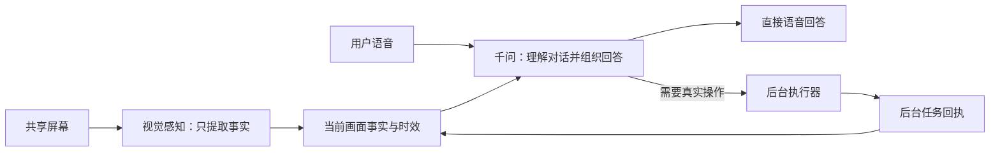

# 语音响应优先与感知/对话分工优化

源码版本：`2026-11-03.responsive-voice.1`。

## 真实原理与证据

当前使用的千问连接是 `qwen-audio-3.1-realtime-plus`。项目向它发送音频、会话指令和工具结果，没有向该连接发送图像。画面由独立视觉路径读取：优先配置的视觉服务，不可用时回退到当前Go聊天模型。运行实例最近一次视觉回执来自 `deepseek-v4.1-flash`，耗时3766毫秒。

此前实时语音已经收到画面摘要：旧实例的共享桥接记录为12次发送、12次服务端确认。因此不能说千问完全没有上下文。更准确的问题是，临时 `read_screen` 仍让视觉层生成一份面向用户的答案，主语音层再处理；UI还会先显示这份文字。再加上语音结果与后台通知共用小队列、回复等待全局工具集合清空等条件，存在文字显示而语音未及时续接的路径。旧记录没有完整队列/首音频时间，无法把某一次无声唯一归因到其中一个条件。

此前 `turn_detection=smart_turn`，界面的停顿毫秒数没有进入该模式。[官方协议说明](https://www.alibabacloud.com/help/en/model-studio/fun-audiochat-client-events)明确：`silence_duration_ms`只在`server_vad`生效，语义断句模式会忽略它。语音前端的旧历史配置还会携带最多50轮服务端历史，以及本地最多16000字符历史；连续后台台词也可能进入提示上下文。

“咕嘎这一层了解屏幕”的可验证含义，应当是：实时对话模型持有当前画面事实与任务状态，可以结合用户问题自行回答，而不是仅显示另一模型写出的答案。音频模型本身不会因接入摘要而具备原始图像编码能力；没有更换模型或扩大付费使用。

## 本轮具体改动

1. **感知层只交事实。** 后台摘要及按需`observe_frame`都记录可见文字、对象、控件和不确定部分，不再替咕嘎写用户答案。`read_screen`回传`observation`；千问结合原问题自行组织语音。界面不再提前把视觉报告显示成最终回复，而显示实际语音转写。
2. **已有画面直接说。** 一般“看得见吗、屏幕是什么”问题可立即使用新鲜缓存，不重新发视觉请求。即使语音模型误将明确的纯画面问题交给执行器，本地也会转回读屏通道；真实点击、填写等指令仍进入执行器。
3. **任务状态进入对话上下文。** 任务进度、当前目标和完成回执被更新到实时模型会话。常见状态问题已有依据时，咕嘎自己先回答；缺少依据时才查工具。任务工作线程继续运行。
4. **前台结果优先。** 原8项普通队列改为优先队列，保留前台结果容量；工具结果优先于后台播报，音频发送线程每轮有限批处理。当前结果不再等待其他无关工具全部完成才开口；请求后续回复时明确要求`audio`和`text`。
5. **减少错误收音门禁。** 音频队列已经播放完后，`playing`不再因为模型仍在生成或等工具而保持true，避免无声等待期间继续封住收音。实际外放播音期间的回声保护仍保留。
6. **缩短断句和历史。** 默认`server_vad`，停顿有效范围200—600毫秒；设置里保留`smart_turn_v2`长句语义断句。服务端历史16轮、本地最多24条/6000字符；连续助手后台台词压为最新一条，完整聊天记录不删除。
7. **减少UI阻塞。** 软件列举和启动通过工具工作线程执行，Windows启动/安全提示的等待不再直接占用Qt对话线程。真正的UI对象改动仍在Qt线程。
8. **保留可定位的计时。** `app_state.voice_path.interaction`提供识别后耗时、首音频、工具回传后首音频、队列失败和后台任务状态等数字，不记录新录音、转写正文或密钥。

## 验收

全套相关回归103项通过；随后增加“连续后台历史压缩”的一项检查，针对语音与历史再运行32项通过。覆盖结果优先与容量预留、无关慢工具不阻挡回应、PCM结束后继续收音、声学/语义模式区分、任务状态可见、Qt事件循环可响应、缓存读屏无需新视觉请求、画面问题不误进执行器等。编译和差异空白检查通过。既有动画资源关闭的ResourceWarning仍存在，本轮未改动画加载。

真实千问API验收使用一段由同一已配置模型合成的通用测试语句，实时输入，无麦克风录制、无扬声器播放；免费额度保护未改变。后台使用“仍在等待”的受控任务状态，不执行真实桌面副作用。

| 测试 | 首段音频相对输入结束/文字提交 | 实际结果 |
|---|---:|---|
| 同一语音、`smart_turn` | 1359毫秒 | 回答“在呢”，后台状态保持运行，0次工具调用 |
| 同一语音、`server_vad` | 891毫秒 | 回答“本鹅在呢”，后台状态保持运行，0次工具调用 |
| 已有画面事实的直接语音描述 | 1063毫秒（文字问题提交后） | 直接说出左蓝圆、右黄方；0次DeepSeek/其他工具调用，返回218880字节音频 |

这是小样本服务对照，不代表普遍平均值、P95或延迟SLA。画面测试使用已知的合成视觉事实，证明主对话模型可直接依据它说话，不包含新的视觉识别耗时；实际新画面仍受视觉服务延迟影响。证据：`runtime/responsive-voice-qa/live-latency.json`。

外放正在播音时仍有回声门禁；需要稳定边听边说时应使用耳机模式。未擅自改用户收音设置，也没有用取消所有回声保护的方式制造表面上的“始终收音”。网络故障和远端推理等待也无法由本机保证固定响应时限。

## 加载与回退

**新版已于2026-11-03加载。** 旧PID70496空闲时调用一次原重启快捷方式，Windows弹出安全警告；用户手动点击运行后，重启回执确认PID70496→58984。app_state核对工程路径一致，agent_harness_version与voice_router_version均为`2026-11-03.responsive-voice.1`；完整访问及管理员身份保持。核对时没有通话，共享关闭，未替用户打开麦克风。当前配置计算得到server_vad、600毫秒断句。

修改前备份：`runtime/upgrades/responsive-voice-20261103-091457/`。旧EXE未重打包；未修改系统安全、用户凭据、模型或免费额度保护。
