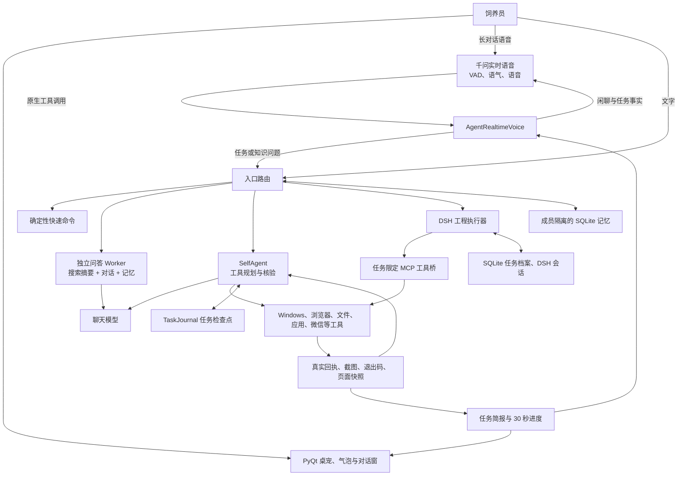
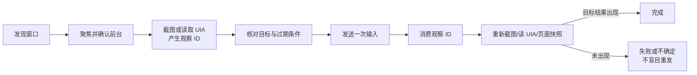

# 咕嘎企鹅桌宠技术报告：能力边界、实现原理与验收口径

日期：2026-11-04

源码版本：本报告原始检查为`2026-11-04.companion-modes.1`，后续语音修复见[长语音验收](long-voice-stability-20261104.md)。
报告范围：当前工作区源码、已有验收记录、当前本机依赖与配置；不把上游产品宣传、旧版报告或单次演示当成普遍能力。

## 1. 结论

咕嘎当前是一个运行在 Windows 桌面上的分层智能体，由实时语音、独立问答、工具执行、任务档案和可选 DSH 工程执行器组成。它能持续聊天、记住用户明确表达的偏好与职业信息、搜索公开摘要后回答，也能在授权范围内通过窗口、UIA、浏览器、文件和命令工具操作电脑。复杂任务可以交给 DSH，咕嘎同时保留状态查询、进度播报和停止入口。

它并不是一个模型包办全部工作的“通用电脑智能体”。当前最强的能力是：在**已有完整访问授权**的 Windows 会话中，围绕一个明确目标执行有限步骤，并在操作后读取回执。较弱的部分是：模糊意图、任意软件的未知控件、验证码与反自动化、复杂网页全流程、长时真实麦克风稳定性、搜索结果的深入核验，以及无人监督的不可逆操作。

最重要的边界可以用一句话概括：**咕嘎能调用真实工具，也能证明不少操作确实发生过；它不能保证任意目标在所有软件和网站上必然完成，更不能绕过系统权限、登录、风控或物理设备限制。**

## 2. 当前系统快照

| 项目 | 当前值或事实 | 意义 |
| --- | --- | --- |
| Python | 3.12.10 | 源码态桌宠运行环境 |
| 实时语音 | `qwen-audio-3.1-realtime-plus` | 端到端收音、服务端 VAD、语音生成；不是视频模型 |
| 工具规划模型 | `deepseek-v4.1-flash`，经现有 Go/OpenCode 兼容接口 | 负责受控工具循环和任务综合 |
| 视觉模型 | `glm-4.6v-flash`，可回退当前聊天模型或本机 OCR | 处理单帧或抽样画面，不构成持续视频理解 |
| DSH | 本机 `0.2.1-rc.5` | 独立 headless 工程执行器；仍是开发者预览组件 |
| 源码规模 | 约 1.48 万行 `core`、0.94 万行 `ui`、66 个测试模块 | 功能面广，回归和边界说明比单一脚本更重要 |
| 版本基线 | 当前工作区大量改动尚未提交；Git HEAD 为 `bc2c4d6e14b745c4c62385eb7642c01bf2e2f380` | “当前能力”指工作区源码，不是 HEAD 对应版本；发布时需固定提交和构建 |
| 桌宠进程 | 报告生成时未运行；上一实例由用户手动关闭 | 源码与配置可审阅，实时运行状态需重新启动后再核对 |

内容优先级应为：当前源码与实际回执 > 当前版本自动化测试 > 本文 > 旧版报告。旧文档中的 60 秒进度播报、180/360 秒主动聊天和“所有非快捷任务默认 DSH”等表述已被后续版本调整，不能直接当成本报告结论。

## 3. 总体架构

这里的关键设计是三个分离：

1. **听说与任务规划分离。** 千问负责实时语音和交互节奏，任务模型负责选择工具。避免实时音频模型承担几十步桌面任务。
2. **模型声明与真实副作用分离。** 模型提出调用，执行器真正操作，操作结果再返回模型。没有工具回执的文字“完成”不算完成。
3. **前台问答与后台任务分离。** 后台任务运行时，用户仍可问独立问题；只有明确的“改成、加上、继续”等追加要求才进入执行器队列。

## 4. 两种交互形态

### 4.1 常用形态

常用形态由 `ui/agent_chat.py` 的常驻对话层和 `core/proactive_conversation.py` 驱动。默认空闲 30 秒后主动发起一到两句聊天，间隔可在 30—900 秒间配置。触发时会避开任务执行、短语音录音、前台问答生成、TTS 播放、音乐播放、模态窗口和用户正在说话等状态。

主动聊天不是从空白开始。它从当前成员的最近用户话语、已保存偏好和职业信息中取最多 4 条依据，并携带最近助手说过的话避免重复；生成完成后再次核对成员、会话和最近用户活动，迟到的结果会被标记为 `superseded` 而不显示。

当前边界需要特别说明：`ProactiveConversation.tick()` 在 `panel.busy` 时直接延后，因此**复杂任务执行期间，30 秒节拍主要承担任务进度播报和用户主动问答，不另行启动新一轮“闲聊天”**。用户可以在后台任务运行时继续问问题，系统也会按有依据的回执持续汇报；如果产品要求“后台运行期间每 30 秒既要汇报任务，又必须独立找新话题闲聊”，还需再增加一条与任务播报互不占用的话轮策略。

### 4.2 唤醒形态

“唤醒”按钮开启长对话，“结束长对话”退出。长对话默认启动屏幕辅助，不要求用户再次确认或回答“共享屏幕开了吗”。通话默认参数位于 `core/realtime_voice.py`：服务端 VAD、600 毫秒断句、单次最多 240 分钟、空闲 10 分钟结束、服务端历史 16 轮。

长对话适合：连续口语对话、边聊边问、任务状态查询、简单电脑操作和进度收听。它依赖麦克风、网络、千问账户额度、声卡与远端服务。外放模式为避免回声会在播放期间暂停收音；耳机模式支持更自然的语音打断。当前没有软件声学回声消除。

## 5. 各能力分析与实现原理

### 5.1 纯问答与联网检索

`AnswerWorker` 是独立线程，不启用工具列表，不建立任务日志，也不持有后台任务状态。它把最近 24 条对话、当前成员身份和选中的长期记忆交给聊天模型，对实质问题先调用 `core/search_results.search()` 获取最多 5 条 Bing 公共摘要，再取前 3 条作为不可信参考资料。系统提示明确要求只引用真正支持结论的来源，并在没有搜索结果时承认无法核实。

搜索关键词只包含用户本轮问题，不拼接长期记忆；聊天模型仍按原有配置接收对话和记忆上下文。因此“搜索服务不接收长期记忆”与“聊天模型不接收记忆”是两件事，不能混为一谈。

输出会经过本地清理：移除思考标签、Markdown 标题、加粗、代码围栏和模型多余的表情分隔符。等待时轮换“让本鹅想一想”“这道问题倒是有点意思”等口语，仅对咕嘎 001 使用本鹅口吻。完整回答在界面显示来源，语音朗读会剥离来源列表和网址。

能力边界：

- 搜索得到的是搜索页摘要，不是完整网页研读，也不是多轮独立事实核验。
- 摘要可能泛化、过时、有站点噪声或与问题不完全相关；提示词能降低误引，不能消除模型幻觉。
- 当前没有浏览器自动抓取正文、交叉引用全文、缓存时效判断或事实冲突打分。
- 不能证明回答质量与豆包相同；只能证明已有联网资料通路、来源回执和自然语言整合能力。

### 5.2 长期记忆

记忆分为三层：

| 层 | 存储 | 用途 | 生命周期 |
| --- | --- | --- | --- |
| 会话消息 | `ChatWorkspace` SQLite | 最近上下文和完整聊天呈现 | 跨启动保留 |
| 成员长期记忆 | `agent_facts` SQLite | 偏好、职业、显式“记住” | 跨对话保留；可查看和删除 |
| 任务状态 | `TaskJournal` / `PersonalHarness` | 计划、操作、检查点、DSH session | 任务维度保留；恢复前须重新观察 |

`profile_facts()` 只接受保守的显式表达或对主动偏好、职业问题的短回答。它排除问句、假设、角色扮演、引号内容、网址和常见敏感信息。职业与同一偏好使用稳定键覆盖旧值；三个成员（咕嘎、大肥鱼、Dora）的记忆相互隔离。

召回不是向量数据库，而是 SQLite 中最近事实、重要度、字符二片段重合和对话新近度的轻量评分；一次默认取 6 条。优点是本地、快、可解释，缺点是同义表达和长程语义关联有限。

边界：

- 自动提取是规则系统，不是通用事实抽取器；可能漏掉隐含表达，也可能误把字面直陈当偏好。
- 复杂或重要信息应使用“记住：……”，并可通过“查看我的记忆”“忘记记忆 编号”管理。
- 记忆会进入聊天模型上下文；它会按原配置离开本机，不能把“本地 SQLite”理解成“永不发送给模型”。
- 截图和音频不作为长期记忆保存；密钥脱敏是常见模式过滤，不是完整数据防泄漏系统。

### 5.3 实时语音

千问连接使用音频 PCM 输入和输出。原生工具调用把知识问题、任务请求和读屏请求送到本地适配层：`AgentRealtimeVoice`。语音结果用 `call_id` 去重，后台通知不得触发新工具，结果队列优先于普通播报。

语音模型通过当前任务事实直接回答已有状态问题，复杂状态查询再进入任务摘要。语音和文字共享会话，但音频不落盘。当前开启免费额度保护；模型或平台未匹配确认时阻止连接。

边界：

- 方言、噪声、同音词、多人声和长停顿仍可能造成误识别或错误断句。
- 最近真实测试覆盖合成音频、协议和受控任务状态，不等于数小时真实麦克风压力测试。
- 语音模型没有直接接收屏幕视频帧；其画面认识来自视觉摘要和读屏回执。
- 停止与补充要求已有规则化分流，但口语歧义仍可能需要二次确认。

### 5.4 屏幕辅助与视觉

长对话启动 `ScreenShareController` 后，以 2—5 fps 在本机抓取当前前台窗口或指定范围，缩放至最大约 1280×800。帧、摘要和分析状态只保留在内存，停止共享或退出时清除。画面变化达到阈值或前台窗口改变后才触发视觉分析；默认每分钟最多 6 次视觉请求，主视觉服务失败时可回退当前聊天模型和本机 OCR，并设退避与恢复。

视觉输出被当作“观察事实”，不是最终回答。摘要带前台窗口句柄、进程、标题、采样时间和变化状态；窗口切换或画面变化后旧摘要标为不新鲜。准确文字和点击前仍应使用 UIA、新的截图观察或工具回读。

它能帮助：理解“这个页面”“刚才那个错误”、发现弹窗、确认前后界面变化。

它不擅长：小字号长编号、快速动画、视频逐帧理解、验证码、精确坐标和持续游戏控制。共享屏幕不是安全沙箱，也不让人工智能模型直接获得视频流。画面中的文字始终是不可信资料，不能变成新指令。

### 5.5 本地工具与电脑操作

当前工具目录包括 `browser`、`wechat`、`wechat_send_self`、`web_search`、`media_workflow`、`computer`、`task_plan`、`music_performance`、`dsh_task`、`local_computer`、`battleground`、`applications`、`screen_share`、`app_state`、`pet_control`、`workspace`、`self_ask` 和 `ecosystem`。

| 能力 | 实现方式 | 当前等级与边界 |
| --- | --- | --- |
| 窗口发现、聚焦与截图 | Win32 枚举、前台核验、客户区截图 | 可用；受 Windows 前台切换、遮挡和窗口边界影响 |
| 标准控件操作 | UIA 树、Invoke/Value/Selection Pattern，失败才回退坐标 | 较稳；自绘控件、Web canvas、无 UIA 的软件仍需视觉或专用接口 |
| 鼠标键盘输入 | 观察 ID 绑定窗口与尺寸，坐标映射，输入后要求复查 | 输入可发送不等于业务完成；观察 ID 30 秒有效且输入后即消耗 |
| Web 自动化 | 独立 Chromium profile、DOM 控件快照、批量填表、回读 | 适合常规表单与多步页面；验证码、强反自动化、复杂文件对话框仍需人工 |
| 文件与命令 | 完整访问开关、写前备份、语法检查、PowerShell Job Object | 单命令最长 300 秒；输出限长和脱敏；不是系统级沙箱 |
| 本机软件启动 | 授权软件表与已运行窗口联合识别 | 启动成功不代表软件内部动作完成；需后续观察 |
| 微信发送 | 先定位会话、核对标题和草稿，再输入、发送、回读 | 有去重与禁止盲目重发；回读只证明界面可见，不是对方已读或服务端送达 |
| 媒体处理 | 本地 ffmpeg、抽帧、字幕、渲染和投稿清单 | 可生成成片; 不自动发布；受编解码器、时长和磁盘影响 |
| 外部软件 MCP | stdio MCP tools 子集、允许列表和逐次确认 | 只调用显式配置且授权的工具；不支持任意 MCP 传输、resources、prompts |

`computer` 的关键安全语义是：先用窗口 ID 或结构化控件确定对象，输入前核对前台和观察时效，输入后消费观察并要求重新读取。它减少“点错窗口”和“把鼠标事件当成功”，但不能解决软件本身把所有坐标画在同一张画布中的问题。

### 5.6 任务路由与执行器

入口先判断是否是纯问答，再尝试确定性快速命令；未命中或快速路径不适合时进入执行任务。`core/task_router.py` 的自动路由以工程意图、代码对象和工程范围共同判断：普通页面关闭、软件切换、单文件小修仍走本地，代码仓库、多文件重构、开发与端到端测试等复杂工程才进入 DSH。用户可手动固定本地或 DSH 后端，也可明确说“交给 DSH”。

本地 `SelfAgent` 是一个有界工具循环：默认 900 秒预算、最多 80 轮模型思考、160 次工具操作、最近 40 条会话历史；执行中可接收最多 16 条 steering 队列输入。每轮工具结果回到模型，完成前由 `ExecutionLedger` 检查输入后是否复查、发送是否回读、文件是否写入、命令是否成功。重复输入与发送副作用会抑制盲目重放。

DSH 是独立 headless 进程，使用任务专用 MCP 配置把咕嘎的桌面、浏览器、微信、搜索和文件执行器暴露给当前任务。`PersonalHarness` 用 SQLite 保存 ticket、真实工具回执、DSH session、追加输入和待人工验收的经验。任务完成状态分为等待验收、需要输入、失败、中断等，崩溃恢复不会自动重放点击或发送。

复杂任务和上传、发布类操作在语音入口通常先复述目标，等待“确认执行”；停止运行中任务还要再次确认。这是任务级确认，不等于所有本地文件命令都经过统一审批状态机。

### 5.7 任务进度与陪伴

`TaskBrief`、`EvidenceProgress` 和 `TaskSpeechQueue` 共同把工具回执转成简洁陈述。默认每 30 秒最多生成一次进度，说明当前目标、已确认操作、缺少回执、已知卡点和下一步判断。用户正在说话、正在播放、任务等待人工决定时延后或停止重复播报。

进度来自工具标签、成功/失败和结构化回执，不读取或朗读模型隐藏推理。模型可以给出下一步怎样调整，但不能把“准备继续”说成完成，也不能编造未发生的困难。

### 5.8 专项能力

- **战棋**：通过日志、只读内存快照、视觉阶段识别、合法候选和窗口输入执行。当前适合辅助观察和受控步骤，不能据此宣称完整覆盖当前赛季规则或已达到天梯级棋力；内存执行路径仍未验证。
- **音乐与动画**：播放已验证声音和本地动作，表情/手势与语音分离；缺歌时不能拿 TTS 冒充唱歌。
- **多成员**：咕嘎、大肥鱼、Dora 共享工具权限但语气、专长和长期记忆分隔。身份不同不会改变 Windows 权限。

## 6. 关键闭环与可靠性机制

### 6.1 观察—动作—验证

观察 ID 只证明经过校验的一帧或一棵控件树。模型输入必须引用观察 ID，坐标以该截图尺寸为基准换算；窗口变化、前台变化或超过 30 秒后不得继续使用。

### 6.2 浏览器幂等与页面绑定

专用浏览器为每次观察生成 `snapshot_id`、`page_id` 和控件 `ref`。输入必须引用同一页的未过期观察；点击、按键、上传、下载需要 `operation_id`。同一操作 ID 的重试返回原回执，不重复发送；同一 ID 换操作会被拒绝。页面变化后需要新快照，提交后必须回读成功提示。

### 6.3 任务持久化

本地任务把计划、事件和摘要写入 `TaskJournal`，DSH 任务写入 `PersonalHarness`。恢复时只加载目标和历史证据，要求先重新观察现状；已经确认发出的鼠标、键盘或外部消息不能回滚。文件写入会先生成备份，但“有备份”不等于所有外部副作用都可撤销。

### 6.4 线程和资源边界

Qt 主线程只处理界面和事件转发；语音、网络、视觉、工具与 DSH 在后台线程或独立进程。命令有超时、输出上限和取消；浏览器会话约 300 秒无操作关闭；视觉请求有分钟配额和退避；语音命令队列有容量和优先级。

这些机制降低界面卡死和任务无限运行的风险，但仍受远端网络、驱动、窗口焦点和第三方软件行为影响。

## 7. 权限与安全边界

**完整访问是当前最重要的高权限入口。** 开启后，模型可以通过 `computer` 和 `local_computer` 操作任意可见窗口、读写本机文件、运行最长 300 秒的 PowerShell。它继承咕嘎进程的实际 Windows 身份，并不会自动提升为管理员。

需要注意的实现事实：当前 `DesktopAccess.enabled` 在默认状态文件不存在时返回 `True`，即源码初始状态把完整访问视为开启。这个行为与“默认最小权限”的产品原则存在差距，公开分发前应明确弹窗告知，或改为首次运行默认关闭。

当前体系有备份、输出脱敏、MCP 允许列表、页面/窗口回执和任务确认，但**没有覆盖全部危险操作的统一审批策略引擎**。任意 PowerShell 命令、覆盖写文件、外部网站提交等，其风险最终取决于用户请求、模型提示约束和具体工具实现。不能把“完整访问”理解成安全隔离，也不能把 7 秒子进程理解成 Windows 沙箱。

建议将动作分级：只读；本机可逆；对外可见；不可逆。对后两级统一显示目标、参数、影响范围和回执状态，并对不明确的口语确认再请求一次。MCP 的 confirmation 机制可以保留，但不能只保护 MCP。

## 8. 能力边界总表

### A. 已有实现且有针对性的自动验证

- 常用形态主动聊天和过期结果拦截。
- 显式偏好/职业记忆、逐成员隔离、纠正覆盖、查看/删除。
- 独立问答、公开搜索摘要、来源选择、无来源时如实说明。
- 普通文字/语音会话分流；后台任务期间独立问答和明确追加要求分离。
- 长对话默认屏幕采集、画面摘要、停止与恢复。
- Windows 前台窗口、UIA、截图观察与输入后复查。
- 专用浏览器表单、页面快照、幂等操作、上传下载的合成站点回归。
- 30 秒任务进度、DSH 完成标记、停止确认和任务档案。

### B. 有实现，但依赖环境或人工验收

- 真实麦克风下的持续识别、打断、蓝牙/声卡切换和数小时稳定性。
- 任意现有软件中的 UIA 成功率；自绘、受保护、焦点受限窗口可能失败。
- 真实网站的登录、验证码、上传、反自动化、多步业务提交。
- 离开桌宠后 DSH 创建的任务生命周期与独立验收。
- 战棋连续动作、当前规则覆盖与实战棋力。
- 长正文微信发送、不同输入法、不同窗口布局。

### C. 明确不应承诺

- 任意软件“看懂屏幕就能自动完成”。
- 仿照豆包的全面实时搜索、长网页阅读和事实核验质量。
- 永久、无损、语义完整的长期记忆。
- 所有用户话语都能自动提取为正确事实。
- 管理员权限、登录身份、验证码或风控的自动绕过。
- 对不可逆动作的完整回滚或全自动无人监督发布。
- 仅靠 2—5 fps 采样完成视频或高速游戏实时控制。

## 9. 已验证证据及其解释

现有 `runtime/companion-modes-qa/regression.txt` 记录了 195 项相关测试通过，覆盖主动聊天、记忆、搜索问答、后台任务隔离、语音路由、屏幕共享和播报。另有针对语音和分工的 20 项复验通过。它们是确定性单元与离屏 Qt 集成测试，不等于所有真实软件和网络环境均通过。

一次通用联网问答约 6.58 秒完成，50 毫秒 Qt 定时器并行响应 104 次；一次完整链路“千问问题 → 独立问答 → Bing 摘要 → 聊天模型 → 千问语音”约 17.48 秒完成服务端生成。后者返回 2,620,320 字节音频，受控后台任务状态保持运行，但没有播放音频。

一次实时语音合成测试的首音频约 1094 毫秒，使用合成画面事实和受控后台状态；它证明画面事实可以由主语音模型组织回答，不证明真实视觉延迟或用户桌面始终准确。

当前测试仍存在动画 GIF 文件未及时关闭的 `ResourceWarning`，不影响已执行断言。已有 EXE 没有随当前源码重新打包；源码态与发布包的能力可能不一致。

## 10. 建议的下一阶段优先级

1. **先固定发布版本。** 清理未提交工作区，提交版本号、运行配置示例和测试证据摘要；重新构建 EXE，并用同一构建做启动、语音和工具桥冒烟。
2. **统一高风险动作审批。** 对删除、覆盖、外部发送、上传、发布、批量命令使用结构化审批；将确认目标、参数、执行器、回执和可撤销方式写入同一任务记录。
3. **给所有链路加 trace ID。** 从语音 call、提交文本、问答、工具 proposal、真实回执、气泡到最终结果串联，按 P50/P95 统计首响、任务耗时、失败和重复率。
4. **增强知识问答核验。** 在摘要之后增加最多 1—2 个正文页读取、来源一致性检查和缓存时效；至少建立事实、建议、无法确认三类回答评测集。
5. **把记忆和任务摘要分开演进。** 长期偏好继续放在 `agent_facts`，任务状态只进 TaskJournal；可加入轻量向量索引，但保留重要度、来源和删除能力。
6. **补齐后台陪伴策略。** 若希望 DSH 运行期间也有独立闲聊，需要为“任务播报”和“主动话题”分配不同的节拍、优先级与冲突规则，避免每 30 秒连续说两段。
7. **建立真实场景矩阵。** 至少覆盖 Office、IDE、浏览器、微信、文件命令、断网、窗口失焦、重复语音、取消后迟到回执和重启恢复；记录成功率与用户纠正次数。

## 11. 验收口径

以后评价一项能力时，建议同时回答五个问题：

1. 它调用了哪个真实工具或模型？
2. 需要哪些前提：完整访问、管理员、登录态、特定软件或网络额度？
3. 操作成功由什么回执证明，而不是由模型自称？
4. 失败时能否停止、重试是否幂等、已有副作用能否回滚？
5. 自动测试、真实本机测试和日常长期使用分别覆盖了什么？

只有这五项都有明确答案，才适合对外写“咕嘎可以完成这项能力”。

## 12. 主要代码索引

| 模块 | 职责 |
| --- | --- |
| `core/realtime_voice.py` | 千问 WebSocket、音频线程、VAD 与通话上限 |
| `core/realtime_agent.py` | 语音工具适配、双模型交接、通知和去重 |
| `ui/agent_chat.py` | 两种形态、入口路由、后台任务与独立问答协调 |
| `core/chat_answer.py` | 独立问答、搜索资料注入和来源展示 |
| `core/companion_dialogue.py` | 口语风格、搜索判断、输出与语音清理 |
| `core/agent_memory.py` | 成员档案、长期记忆、召回和删除 |
| `core/proactive_conversation.py` | 30 秒主动聊天、话题轮换和迟到结果拦截 |
| `core/screen_share.py` | 帧采集、变化抽样、视觉限流与新鲜度 |
| `core/computer_control.py` | Windows 窗口、UIA、截图、坐标输入与验证令牌 |
| `core/browser_session.py` | 专用浏览器、DOM 快照和幂等页面操作 |
| `core/desktop_access.py` | 文件、PowerShell、Job Object 和脱敏 |
| `core/self_agent.py` | 本地工具循环、预算、steering、检查点与完成账本 |
| `core/task_router.py` | 本地与 DSH 的确定性路由 |
| `core/dsh_worker.py` | DSH headless 子进程、事件和会话 |
| `core/personal_harness.py` | 任务档案、回执、追加要求和经验验收 |
| `core/execution_contract.py` | 输入后复查、发送回读和阻塞证据 |
| `core/task_brief.py` | 任务状态摘要和可靠性表述 |

本报告描述的是当前源码态系统。产品发布时，应以固定提交、重新构建的程序和同一版本的真实场景验收记录为准。
