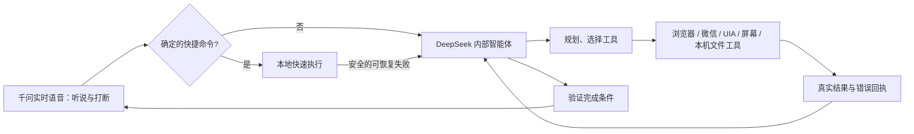

# 语音到内部智能体的交接修复（2026-10-22）

当前 harness `2026-10-22.4`，语音路由 `2026-10-22.5`。

## 已确认原因

1. 快速路由将未知的“打开某某”直接当作本机软件名，失败后没有恢复路径。截图中的网站请求正好落入这个问题。
2. 内层提示词要求“简短操作必须走本地路由”，限制了模型使用通用工具解决快捷函数以外的任务。
3. 微信先前有独立的一次写作旁路，没有进入完整的工具执行循环。
4. 桌宠形象实际遮挡了微信搜索框；普通窗口切换也可能受 Windows 前台窗口规则影响。

## 当前执行链路

内部系统提示明确用户来自实时语音、口语可能重复或转写错误、需要接收追加要求；不把语音模型当执行器。快捷失败携带原文与失败回执交接，避免再掉回同一路由。工具响应保留模型推理上下文，推理不作为语音或进度播报。

DeepSeek 请求启用 `thinking=enabled`、`reasoning_effort=high`，默认单轮输出上限4096，读超时60秒。简单确定指令继续本地执行。

## 微信工作流

按用户约定，搜索指定名称，选择联系人或聊天记录中的首个匹配项。测试对象改为用户小号“小军”。

1. `wechat.open(recipient)`：定位微信、搜索、点首个匹配项、核对会话标题。
2. 工具返回会话凭据；DeepSeek 再组织用户想发送的正文。
3. `wechat.send(recipient,text,chat_token)`：凭据有效时直接复查当前会话，避免再次搜索；保留已有草稿，输入后核对正文和对象，再点击发送。
4. 聊天区回读到正文才给出 `verified_message_visible`。这不代表服务器送达确认。

工具操作期间临时隐藏咕嘎，正常或异常退出均恢复。相同正文在本轮已经点击发送后，再次调用沿用上次回执，不自动重发。只有进入会话的回执不能满足发消息任务的完成条件。

## 验证与限制

- 91项回归检查及真实离屏Qt语音气泡检查通过。
- 真实OpenCode Go DeepSeek请求：网站任务约2.5秒返回 `browser.open(https://www.bilibili.com)`，存在推理内容。
- 真实DeepSeek请求：微信任务约3.4秒返回 `wechat.open(recipient=小军)`，存在推理内容。
- 离线执行循环验证：先打开会话，再发送；重复工具调用只实际发送一次；失败或打开会话不能伪报发送完成。
- 用户后续实测确认：“成功找到了小军，并进行发送”。较长正文的真实发送尚待用户验收。
- 微信OCR受窗口布局、输入法、遮挡和可见内容影响；通用任务仍需根据实际错误进行恢复，不能承诺任意软件任务必定完成。

普通Edge TTS、声纹关闭状态、长语音连接配置保持原设置。

## 2026-10-22.5：已运行窗口与视觉输入修复

- `computer.windows(query)` 增加进程名、可执行路径、PID、窗口类、前台及最小化状态。优先按进程身份匹配，避免文档标题提到“微信”就误认软件。先筛选再限制数量。
- `applications.list` 区分已安装软件和已运行窗口。`open` 发现唯一运行窗口时恢复并聚焦；发现多个时返回候选供模型选择，不重复启动。多个候选必须聚焦并观察后才能通过完成检查。
- 用户提到“已经打开/这个窗口”等时，在第一次模型请求前加入只读窗口清单。最小化窗口仍属于已运行软件。
- 修复微信工具顶层 `_image_url` 被丢弃的问题，截图按多模态消息传给内部模型；截图像素不进入活动日志或任务检查点。
- 当前 OpenCode Go `deepseek-v4.1-flash` 真实请求测试：正确读取临时图片中的随机7位验证码、红色方形与蓝色圆形，约2.8秒。这验证当前接口的静态图像理解，不等于持续视频共享或保证任何界面都能识别。
- 真实模型的长正文组织测试：`wechat.open` 后提供模拟会话回执，再生成304字单段正文和带会话凭据的 `wechat.send` 调用，约9.4秒。此测试没有执行微信输入或实际发送，不能当作长正文实机验收。
- 本阶段检查：98项回归及离屏Qt语音气泡检查通过；系统只读窗口清单确认运行中的微信即使最小化仍可发现。
